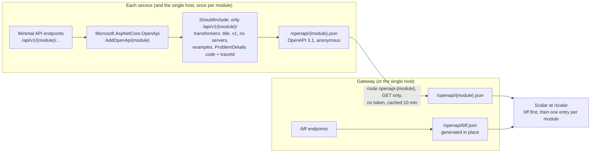

# SmartSpare — API documentation

How the HTTP API is described and published: one OpenAPI document per module, one for the session endpoints under
`/bff`, and the Scalar reference, all public ([ADR 0019](../adr/0019-public-api-documentation.md) and its amendment 1,
decision D4 of the product owner). Every module endpoint they describe still requires a signed-in user.

## 1. Where to find it

| | Single host (development) | Gateway (production, `--topology services`) |
|---|---|---|
| Scalar reference | `https://localhost:7080/scalar` | `https://localhost:7090/scalar` locally; `<gateway>/scalar` in Azure |
| Session document | `/openapi/bff.json` | the same path, generated by the gateway itself |
| Module documents | `/openapi/identity.json`, `/openapi/inventory.json`, `/openapi/fleet.json`, `/openapi/procurement.json`, `/openapi/forecasting.json`, `/openapi/reporting.json` | the same paths, proxied to each service |

**Open it locally:**

```bash
dotnet run --project src/SmartSpare.AppHost                       # single host
# or
dotnet run --project src/SmartSpare.AppHost -- --topology services  # gateway + services
```

Then open `/scalar` on the host or the gateway (the Aspire dashboard lists the URL). No sign-in is needed to read the
documentation. To try a request from Scalar, sign in to the web app in the same browser first (section 4). The
document of one module can also be fetched directly, for example `curl -k https://localhost:7080/openapi/identity.json`.

## 2. How the documents are produced



- **Generation:** ASP.NET Core 10's built-in `Microsoft.AspNetCore.OpenApi`, no Swashbuckle. [`ApiDocumentation.AddModuleDocuments`](../../src/BuildingBlocks/SmartSpare.Infrastructure/Http/ApiDocumentation.cs) registers one document per module, named after it. The single host registers all six, and a service only its own. [`BffEndpoints.AddBffDocument`](../../src/BuildingBlocks/SmartSpare.Bff/BffEndpoints.cs) registers the `bff` document in the gateway and the single host, the two hosts that serve `/bff`.
- **What a document contains:** only the module's versioned business endpoints, `/api/v1/{module}/...` (`ShouldInclude`). Left out on purpose (ADR 0019 §3):
  - `/internal/*`, the service-to-service endpoints;
  - operational endpoints: module pings and the diagnostics probe, marked with `.AsOperational()`;
  - health probes;
  - server addresses.
- **Descriptions:** every endpoint declares them next to its mapping:
  - summary and description: `WithSummary`, `WithDescription`;
  - typed responses: `Produces<T>`, `ProducesProblem`, `ProducesValidationProblem`;
  - query and route parameters: `[Description]`;
  - examples: `WithRequestExample`, `WithResponseExample`.

  The request and response records in `SmartSpare.ApiContracts` describe each field with `[Description]`.
  XML documentation comments are not used for this: the documents are built in `SmartSpare.Infrastructure`, which references no module, so the XML-comment generator never sees module code (#97).
- **Shared conventions** ([`OpenApiConventions`](../../src/BuildingBlocks/SmartSpare.Infrastructure/Http/OpenApiConventions.cs)), applied to every document:
  - the examples declared on the endpoint, serialized with the API's own JSON options;
  - the `code` and `traceId` members of ProblemDetails;
  - the `Retry-After` header of 429 responses;
  - numbers typed as JSON numbers.

  Examples use the synthetic T001 personas and parts only (ADR 0019 §3).
- **Publication:**
  - Each service maps `/openapi/{module}.json` anonymously.
  - The gateway proxies it through the `openapi-{module}` route: GET only, without the user's token, cached for 10 minutes and rate-limited per client IP ([`GatewayRoutes.cs`](../../src/Bootstrapper/SmartSpare.Gateway/GatewayRoutes.cs)).
  - The single host serves the same paths with the same cache and limit.
- **Scalar:** [`ApiReference.MapApiReference`](../../src/BuildingBlocks/SmartSpare.Bff/ApiReference.cs) in both BFF hosts (`Scalar.AspNetCore` 3.2, MIT).
  - Its assets are served locally and its fonts aren't loaded from a CDN.
  - Telemetry, the AI agent, MCP and the hosted developer tools are switched off, so nothing is sent to Scalar's services.
  - Its page has its own CSP, `script-src 'self' 'nonce-…'`, with a fresh 144-bit nonce per response. Every other page keeps the stricter stage 3 policy.

**Content today** (stage 6). The Inventory API of stage 5, the Fleet API of stage 6 and the user administration of
Identity are described in full:

| Document | Operation | Policy | Responses |
|---|---|---|---|
| `bff` | `POST /bff/login`: sign in | anonymous, rate-limited | 204; 400 `SS-AUTH-001` or `SS-AUTH-002`; 429 `SS-AUTH-005` with `Retry-After` |
| `bff` | `POST /bff/logout`: sign out | signed in | 204; 400 `SS-AUTH-002`; 401 `SS-AUTH-003` |
| `bff` | `GET /bff/me`: the current user | anonymous | 200 (`isAuthenticated` false when anonymous) |
| `bff` | `GET /bff/antiforgery`: a request token | anonymous | 200 |
| `inventory` | `GET /api/v1/inventory/parts?search=&page=&pageSize=`: search the catalogue | `ReadInventory` | 200 `PagedResponse<PartSummary>`; 400 validation; 401; 403 |
| `inventory` | `GET /api/v1/inventory/parts/{id}`: a part with its stock per warehouse | `ReadInventory` | 200 `PartDetails`; 401; 403; 404 `Inventory.PartNotFound` |
| `inventory` | `GET /api/v1/inventory/warehouses`: the warehouses | `ReadInventory` | 200; 401; 403 |
| `inventory` | `GET /api/v1/inventory/stock?warehouseId=&status=&search=&page=&pageSize=`: the stock overview | `ReadInventory` | 200 `PagedResponse<StockRow>`; 400; 401; 403 |
| `inventory` | `GET /api/v1/inventory/stock/{warehouseId}/{partId}`: a position with reservations and recent movements (ETag) | `ReadInventory` | 200 `StockPositionDetails`; 401; 403; 404 `Inventory.StockPositionNotFound` |
| `inventory` | `PUT /api/v1/inventory/stock/{warehouseId}/{partId}/levels` with `If-Match`: safety and maximum stock | `PlanInventory` | 200 `StockRow`; 400; 401; 403; 404; 409 `Database.ConcurrencyConflict` |
| `inventory` | `GET /api/v1/inventory/movements?warehouseId=&partId=&type=&from=&to=&page=&pageSize=`: the stock ledger | `ReadInventory` | 200 `PagedResponse<MovementRow>`; 400; 401; 403 |
| `inventory` | `POST /api/v1/inventory/stock-adjustments`: a stock count correction with an adjustment reason (a note only when the reason requires one) | `MoveStock` | 201 `StockAdjustmentResponse`; 400 (incl. `Inventory.NoteRequired`); 401; 403 `SS302`; 404 (incl. `Inventory.ReasonNotFound`); 409 `SS200`; 422 `SS500` (archived reason), `Inventory.ReasonDirection` |
| `inventory` | `GET /api/v1/inventory/transfers?status=&warehouseId=&page=&pageSize=`: transfer orders | `ReadInventory` | 200 `PagedResponse<TransferSummary>`; 400; 401; 403 |
| `inventory` | `GET /api/v1/inventory/transfers/{id}`: an order with lines, timeline and `allowedActions` | `ReadInventory` | 200 `TransferDetails`; 401; 403; 404 `Inventory.TransferNotFound` |
| `inventory` | `POST /api/v1/inventory/transfers`: propose a transfer | `PlanInventory` | 201 `TransferDetails`; 400; 401; 403; 422 `Inventory.NoRoute`, `Inventory.UnknownPart` |
| `inventory` | `POST /api/v1/inventory/transfers/{id}/approve` | `ApproveTransfer` + brand scope | 200; 401; 403 `Inventory.OutOfBrandScope`; 404; 409 `SS200`, `SS201`, `SS300` |
| `inventory` | `POST /api/v1/inventory/transfers/{id}/cancel` with a reason | `CancelTransfer` + brand scope | 200; 400; 401; 403; 404; 409 `SS300` |
| `inventory` | `POST /api/v1/inventory/transfers/{id}/dispatch` and `/receive` | `MoveStock` | 200; 401; 403 `SS302`; 404; 409 `SS300` |
| `inventory` | `POST /api/v1/inventory/imports` (multipart `source`, `file`): CSV import raw → staging → core | `ImportData`, 5 a minute | 201 `ImportBatchDetails` (status `loaded` or `failed`); 400 `Inventory.ImportHeader` and others; 401; 403; 409 `Inventory.ImportDuplicate`; 429 |
| `inventory` | `GET /api/v1/inventory/imports` and `/imports/{id}`: batches and their row errors | `ImportData` | 200; 401; 403; 404 `Inventory.ImportNotFound` |
| `inventory` | `GET /api/v1/inventory/assignment-roles?kind=`, `GET /brands`, `GET /brands/{id}/responsibles`, `GET /warehouses/{id}/responsibles`: assignment roles, brands and the responsible employees of a record | `ReadInventory` (reads are never scoped) | 200; 401; 403 |
| `inventory` | `GET /api/v1/inventory/adjustment-reasons?search&archived&sort&page&pageSize`, `/lookup?search&limit`, `/{id}` (with `ETag`), `/{id}/history?page&pageSize`: the adjustment reasons catalogue built by the master-data mechanism (ADR 0025) | `ReadInventory` | 200 (`PagedResponse<AdjustmentReasonDto>`, `CatalogLookupItem[]`, `AdjustmentReasonDto`, `PagedResponse<RecordHistoryEntry>`); 400 `Catalog.InvalidPaging`; 401; 403; 404 `Catalog.NotFound` |
| `inventory` | `POST /api/v1/inventory/adjustment-reasons`, `PUT /{id}`, `POST /{id}/archive`, `/restore`: create, change, archive and restore; writes need `If-Match` | `ManageCatalog` | 200/201 `AdjustmentReasonDto` with `ETag`; 400 `Catalog.VersionRequired`, `Catalog.BodyRequired`; 401; 403; 404; 409 `Catalog.CodeTaken`, `SS501` (with `reasons`), stale version; 422 `Catalog.CodeFixed` (only an administrator changes a code) |
| `inventory` | `PUT /api/v1/inventory/brands/{id}/responsibles`, `PUT /warehouses/{id}/responsibles`: replace the responsible employees; a change of a rights-bearing role (brand manager, keeper, service base) publishes `ResponsibilitiesChanged` to Identity (ADR 0026) | `Administration` | 200 `ResponsibleDto[]`; 400 `Inventory.UnknownAssignmentRole`; 401; 403; 404; 422 `Inventory.UnknownEmployee` |
| `fleet` | `GET /api/v1/fleet/machines?search=&warehouseId=&status=&dueStatus=&page=&pageSize=`: machines with their next service | `ReadFleet` | 200 `PagedResponse<MachineSummary>`; 400; 401; 403 |
| `fleet` | `GET /api/v1/fleet/machines/{id}`: the machine card with every plan's due calculation and recent readings | `ReadFleet` | 200 `MachineDetails`; 401; 403; 404 `Fleet.MachineNotFound` |
| `fleet` | `GET /api/v1/fleet/machines/{id}/readings?page=&pageSize=`: the reading history | `ReadFleet` | 200 `PagedResponse<ReadingRow>`; 401; 403; 404 |
| `fleet` | `POST /api/v1/fleet/machines/{id}/readings`: record engine hours; drafts the services due within 50 h | `RecordServiceWork` | 201 `RecordReadingResponse` (200 with `replayed` for an identical retry); 400; 401; 403; 404; 409 `Fleet.ReadingConflict`; 422 `SS100`–`SS104` |
| `fleet` | `GET /api/v1/fleet/maintenance/due?warehouseId=&horizonDays=&status=&page=&pageSize=`: due maintenance | `ReadFleet` | 200 `PagedResponse<DueMaintenanceRow>`; 400; 401; 403 |
| `fleet` | `GET /api/v1/fleet/maintenance-plans?modelId=`: OEM plans with their kits | `ReadFleet` | 200; 401; 403 |
| `fleet` | `GET /api/v1/fleet/service-orders?status=&warehouseId=&machineId=&page=&pageSize=`: service orders with kit status | `ReadFleet` | 200 `PagedResponse<ServiceOrderSummary>`; 400; 401; 403 |
| `fleet` | `GET /api/v1/fleet/service-orders/{id}`: an order with its kit lines and `allowedActions` | `ReadFleet` | 200 `ServiceOrderDetails`; 401; 403; 404 `Fleet.ServiceOrderNotFound` |
| `fleet` | `POST /api/v1/fleet/service-orders`: a planned service or an unplanned repair | `ManageServiceOrders` | 201 `ServiceOrderDetails` (kit `reserving`); 400; 401; 403; 404; 409 `Fleet.ServiceOrderExists`; 422 `Fleet.UnknownPart` |
| `fleet` | `POST /api/v1/fleet/service-orders/{id}/start` | `RecordServiceWork` | 200; 401; 403; 404; 409 `SS300` |
| `fleet` | `POST /api/v1/fleet/service-orders/{id}/complete` with the engine hours; Inventory issues the kit (shortfall rule) | `RecordServiceWork` | 200 (an identical repeat is a safe retry); 400; 401; 403; 404; 409 `SS300`; 422 `Fleet.CompletionHoursTooLow` |
| `fleet` | `POST /api/v1/fleet/service-orders/{id}/cancel` with a reason; Inventory releases the kit | `ManageServiceOrders` | 200; 400; 401; 403; 404; 409 `SS300` |
| `fleet` | `PUT /api/v1/fleet/service-orders/{id}/lines`: the whole kit of an order that has not started; Inventory adjusts the holds | `ManageServiceOrders` | 200 (kit `reserving` when lines were added or changed); 400 (`Fleet.NoLines` for a repair without lines); 401; 403; 404; 409 `SS300`; 422 `Fleet.UnknownPart` |
| `identity` | `GET /api/v1/identity/users?search=&page=&pageSize=`: accounts with masked data, the employee's position and every effective right with its origin (ADR 0026) | `Administration` | 200 `PagedResponse<UserSummary>`; 400; 401; 403 |
| `identity` | `GET /api/v1/identity/users/form-options`: roles, brands, active hubs | `Administration` | 200; 401; 403 |
| `identity` | `GET/POST /api/v1/identity/positions`, `GET/PUT /positions/{id}`, `POST /positions/{id}/archive`, `/restore`: positions and their role templates; writes need `If-Match` | `Administration` (writes as `app_admin`) | 200/201 `PositionSummary` with `ETag`; 400 `Identity.VersionRequired`; 401; 403; 404; 409 `Identity.CodeTaken`, `Identity.LastAdministrator`, `SS501` (position in use), stale version |
| `identity` | `GET/POST /api/v1/identity/employees`, `GET/PUT /employees/{id}`, `POST /employees/{id}/archive`, `/restore`, `/account`, `/anonymise`: employees, their account (the only way to create one) and GDPR erasure | `Administration` (writes as `app_admin`) | 200/201 `EmployeeSummary` with `ETag`; 400; 401; 403 (`SS301` for the own employee); 404; 409 `Identity.AccountExists`, `Identity.UserNameTaken`, `Identity.LastAdministrator`; 422 `SS500` (archived position) |
| `identity` | `POST /api/v1/identity/users/{id}/unlock`, `/deactivate`, `/anonymise` | `Administration` | 200 `UserSummary`; 401; 403 (`SS301` for the own account); 404; 422 |
| `identity` | `POST /api/v1/identity/me/password`: change the own password | any signed-in user | 204; 400 `Identity.WrongPassword`; 401 |

`ReadInventory` and `ReadFleet` admit every role but not a user without one. Reads are never brand-scoped
(STAGE_3_PLAN §3.3). `RecordServiceWork` and `ManageServiceOrders` have the same roles as the SQL functions behind them,
checked by `PolicySqlRoleParityTests` including the EXECUTE grants. The Procurement, Forecasting and Reporting documents
fill as stages 7–9 add `/api/v1` endpoints, each with its summary, response types and examples (#54).

## 3. Conventions

**Versioning** ([ADR 0012](../adr/0012-evolvability-principles.md)):
- Business endpoints live under `/api/v1/{module}/...`. A breaking change gets `/api/v2/...` beside v1.
- Operational endpoints (`/api/{module}/ping`, diagnostics) are unversioned and must carry `.AsOperational()`. The test `Every_unversioned_module_endpoint_is_marked_operational` fails otherwise, so no business endpoint escapes versioning.
- The gateway routes both with literal module names: `/api/v1/inventory/{**rest}` and `/api/inventory/{**rest}`.
- `/internal/v1/{module}/...` is for service-to-service calls only. It is never routed by the gateway (route-table test) and never documented.

**Errors** (RFC 9457 ProblemDetails, `application/problem+json`). Every error response carries:
- `status`, `title` and `detail`;
- `traceId`, the W3C trace id, shown to users as "Reference" ([TRACING.md](../operations/TRACING.md));
- a stable `code`:

| Code | Status | Meaning |
|---|---|---|
| `SS-AUTH-001` | 400 | Sign-in failed (the same for every cause) |
| `SS-AUTH-002` | 400 | Missing or invalid antiforgery token on an unsafe request |
| `SS-AUTH-003` | 401 | No valid session |
| `SS-AUTH-004` | 403 | Signed in, but the policy or brand scope doesn't allow it |
| `SS-AUTH-005` | 429 | Too many attempts; see `Retry-After` |
| `SS-SYS-001` | 503 | A service the request needs didn't answer (gateway topology) |
| `SS100`–`SS402` | 400–422 | Business rules enforced by the database, mapped by `DatabaseErrorMapper`; the full list is in [DATABASE_DESIGN.md §6.3](../database/DATABASE_DESIGN.md#63-triggers-functions-and-procedures-business-logic) (SS104, a reading in the future, since stage 6) |
| `<Module>.<Error>` | 400–422 | Module errors from `Result<T>`, for example `Identity.InvalidCredentials` |

The codes are defined in [`ProblemCodes`](../../src/Web/SmartSpare.ApiContracts/ProblemCodes.cs) and the module error classes; `ProducesProblem` declares them per endpoint.

**Status codes:** `Result<T>` maps to 200 with a body or 204 without one; its errors to 400 (validation), 403, 404, 409 (conflict) and 422 (business rule) ([`ResultHttpExtensions`](../../src/BuildingBlocks/SmartSpare.Infrastructure/Http/ResultHttpExtensions.cs)); authentication gives 401, the rate limiter 429, an unreachable service 503. Creating endpoints (stages 5–9) answer 201 with `Location`.

**JSON:** the ASP.NET Core web defaults (camelCase properties, ISO 8601 dates); request and response types are the records of `SmartSpare.ApiContracts`, shared with the web client.

**Lists and paging:**
- A list that can grow is paged with `page` (from 1) and `pageSize` (default 25, at most 100).
- The answer is `PagedResponse<T>`: `items`, `page`, `pageSize` and `totalCount`, the number of all matches.
- A page past the end is empty, not an error. An invalid `page` or `pageSize` is a 400 validation problem.
- Search text matches literally: `%` and `_` are not wildcards.
- Short reference lists, such as the seven warehouses, are returned whole.

## 4. Authentication

The `bff` document describes these endpoints with examples and every error. The API has no API keys and no bearer tokens for browsers ([ADR 0014](../adr/0014-browser-sign-in-through-bff-endpoints.md), [ADR 0016](../adr/0016-authentication-behind-the-gateway.md)):

1. `GET /bff/antiforgery` returns the antiforgery request token and its header name (`X-XSRF-TOKEN`).
2. `POST /bff/login` with `{ "userName", "password", "rememberMe" }` and that header sets the HttpOnly cookie `__Host-SmartSpare`.
3. Every API call then sends the cookie automatically. Unsafe methods (POST, PUT, PATCH, DELETE) also send `X-XSRF-TOKEN`; fetch a new token after sign-in, because it is bound to the user.
4. `GET /bff/me` tells whether the session is signed in, and `POST /bff/logout` ends it.

Behind the gateway, each request reaches the services with a 2-minute ES256 internal token that only the gateway can
mint; clients never see it. Try-it calls from Scalar are same-origin, so they work in a browser that has signed in to the
web app. The `/bff` endpoints are part of the BFF, not of a module, so they have their own document, generated by the
gateway or the single host (ADR 0019, amendment 1).

## 5. Tests

| Test | What it checks |
|---|---|
| `ApiDocumentationTests` (host integration) | Each module document is anonymous, OpenAPI 3.1, titled, without servers, and lists only that module's `/api/v1` paths; the path filter on business, operational, internal, other-module and health paths; the `inventory` document's operations, parameters, responses, examples and field descriptions; the `bff` document's operations, examples, error codes and `Retry-After`; `code` and `traceId` in the ProblemDetails schema; every `/api/v1` endpoint requires authorization; `/scalar` runs only its nonce script, with a fresh nonce per response and no CDN; other pages keep the stage 3 policy |
| `InventoryApiTests` (host integration, PostgreSQL) | Search by part number or description, paging and `totalCount`, literal wildcards, deactivated parts, a part with its stock, 404 `Inventory.PartNotFound`, the warehouses, validation problems, every role allowed, 401 and 403 |
| `ServiceStartTests` | Each service publishes only its own document (404 for others) |
| `GatewayTests` | The gateway proxies module documents anonymously without a token, GET only, and generates the `bff` document itself; `/internal` is never forwarded; the route table can't match `/internal` |
| `TopologyTests` | The Inventory API through the real gateway and service, as the `smartspare_inventory` login, including a 404 ProblemDetails |
| `GatewayUnitTests.Every_unversioned_module_endpoint_is_marked_operational` | No business endpoint outside `/api/v1` |
| `ApiReferenceTest` (Playwright) | `/scalar` renders in Chromium with no CSP violation and no request to another origin |
