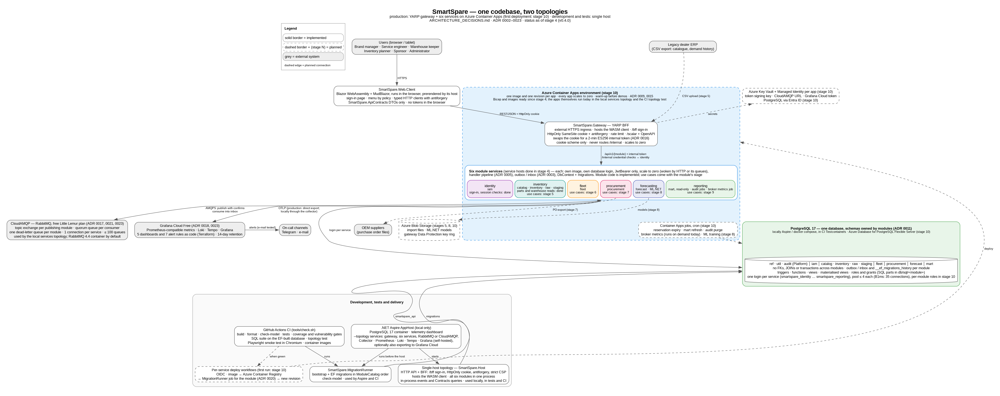

# SmartSpare — Solution Architecture

> **Status: superseded.** This document describes the architecture baseline of the database stage. The approved target architecture is in [ARCHITECTURE_DECISIONS.md](ARCHITECTURE_DECISIONS.md) and the ADRs in [`docs/adr/`](../adr/README.md). Where they differ (MediatR, JWT in the browser, database-first mapping, cross-module transactions, `SmartSpare.DbMigrator`), the decisions take precedence.

Prerequisite for the database stage ("project architecture designed, database type chosen"). Based on the BA/SRS (Sections 2.3–2.7) and the diploma application (technology stack).

## 1. Architectural style

**Modular monolith** with **Clean Architecture** and **CQRS via MediatR** (BA 2.4, alternative 2 selected): one deployable ASP.NET Core 10 application on Azure App Service, one PostgreSQL database. Microservices were rejected in the BA (≥ €300/month, DevOps overhead for an individual project); the modular structure keeps the option to extract a module later.

| Layer (project) | Responsibility | May reference |
|---|---|---|
| `SmartSpare.Domain` | entities, value objects, domain rules (engine-hour thresholds, MOQ rounding, net position) | nothing (NFR06) |
| `SmartSpare.Application` | MediatR commands/queries per module, validation (FluentValidation), pipeline behaviours: logging, validation, **transaction** | Domain |
| `SmartSpare.Infrastructure` | EF Core 10 + Npgsql (database-first mapping), `SessionContextInterceptor`, `DatabaseErrorMapper`, Blob storage, ML.NET runtime, Quartz.NET jobs | Application, Domain |
| `SmartSpare.Api` | REST endpoints, JWT authentication (Identity, PBKDF2), role policies, OpenAPI, ProblemDetails, hosts Blazor WASM | all |
| `SmartSpare.Web` | Blazor WebAssembly + MudBlazor, adaptive layouts (NFR05, WCAG 2.1 AA) | shared DTOs |
| `SmartSpare.DbMigrator` | applies `db/migrations` + `db/seed` in the pipeline | Npgsql only |
| `tests/*` | unit (Domain), integration (Testcontainers PostgreSQL + `db/tests`), architecture tests (NetArchTest/ArchUnitNET), Playwright UI | — |

## 2. Modules and their database schemas

| Module | Epics / stories | Schema(s) owned | Key DB objects |
|---|---|---|---|
| Fleet & Maintenance | EP01: US01, US02, US05, US06 | `fleet` | `log_engine_hours`, `fn_maintenance_due`, reading triggers |
| Inventory | EP02, EP04: US03, US04, US08, US10, US11, US15, US18 | `catalog`, `inventory` | ledger → balance triggers, transfer workflow functions |
| Procurement | EP05: US12–US14, US16, US17 | `procurement` | PO line validation, four-eyes approval |
| Forecasting | EP03: US07, US09 | `forecast`, `mart` | model registry, `promote_model`, `fn_stock_position`, data marts |
| Identity & Access | NFR04 | `iam` | users, roles, masking, anonymisation |
| Import | C.2 data migration | `raw`, `staging` | `staging.process_batch` |
| Cross-cutting | US18, GDPR | `audit`, `util`, `ref`, `meta` | audit trigger, partitions, document numbers |

Rule: a module writes only to its own schema; it reads other modules through views/functions or foreign keys. Cross-module workflows (e.g. accepting a recommendation creates a transfer order) are executed in **one database transaction** by a function of the initiating module.

## 3. Request flow (CQRS)

* **Commands** (state changes): Endpoint → MediatR command → validation → `TransactionBehavior` opens a transaction (the interceptor sets `app.user_id`/`app.reason`) → handler uses EF Core for simple writes and calls the database business function for invariants that involve stock or status (e.g. `SELECT inventory.approve_transfer(@id)`) → commit. PostgreSQL errors (custom SQLSTATE `SS1xx–SS4xx`, constraint violations) are mapped to HTTP 409/422/403 problem details.
* **Queries** (reads): MediatR query → `AsNoTracking` projection on the read views (`v_stock_overview`, `v_recommendation_explained`, …) — no business logic duplicated in LINQ.
* **Optimistic concurrency** for edited documents: `xmin` mapped with `IsRowVersion()` → `DbUpdateConcurrencyException` → 409 → the UI reloads (UC01 E1).

## 4. Background processing (Quartz.NET, connection `smartspare_jobs`)

| Job | Schedule | Database call |
|---|---|---|
| Expire soft reservations | every 15 min | `CALL inventory.expire_soft_reservations()` |
| Refresh data marts | nightly 02:00 and after each import | `CALL mart.refresh_all()` |
| Retraining + benchmark | weekly (Sunday night) | insert `ml_model_version` (candidate) + `benchmark_result`, then `forecast.promote_model()` |
| Forecast + recommendations | weekly / on user request (UC01) | `forecast_run`, `demand_forecast`, `recommendation` |
| Partition maintenance | monthly | `util.ensure_monthly_partitions(...)` 12 months ahead |
| Audit retention | monthly | `CALL audit.purge_expired('180 days')` |
| Expire old recommendations | daily | `CALL forecast.expire_open_recommendations()` |

## 5. Deployment (Azure, NFR07 ≤ €35/month)

* Azure App Service (Linux, B1/B2) — API + Blazor static files + Quartz jobs in one container.
* Azure Database for PostgreSQL Flexible Server (Burstable B1ms, PostgreSQL 17, EU region, TLS 1.2+, daily backups / PITR — NFR09).
* Azure Blob Storage — versioned ML.NET model files (`ml_model_version.artifact_uri`, SHA-256 verified on load).
* Azure Key Vault — DB passwords, JWT signing key, pseudonymisation key; App Service uses a managed identity.
* GitHub (private repository) + GitHub Actions: build → unit tests → integration tests on a PostgreSQL service container (bootstrap + migrations + test data + `db/tests`) → DbMigrator against Azure → deploy.

## 6. Key decisions

| # | Decision | Rationale |
|---|---|---|
| D1 | Modular monolith, one DB with one schema per module | cost and simplicity; boundaries still explicit |
| D2 | PostgreSQL only (no ClickHouse/Redis) | data volume and NFR07; analytics in a data-mart layer (see Database Design §1.2) |
| D3 | Schema owned by versioned SQL migrations; EF Core database-first | most schema objects are not expressible in EF models; SQL is reviewable/testable |
| D4 | Critical invariants enforced in the DB (constraints, triggers, functions) | NFR03 must hold for every writer (API, jobs, imports); concurrency handled with row locks where the data are |
| D5 | Ledger + derived balance | auditability (US18) and demand history for ML from one source |
| D6 | Separate DB login per workload, least privilege | no superuser at runtime; blast radius of a leaked credential is limited |
