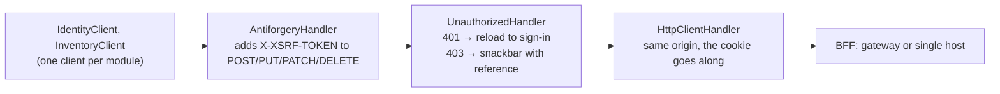
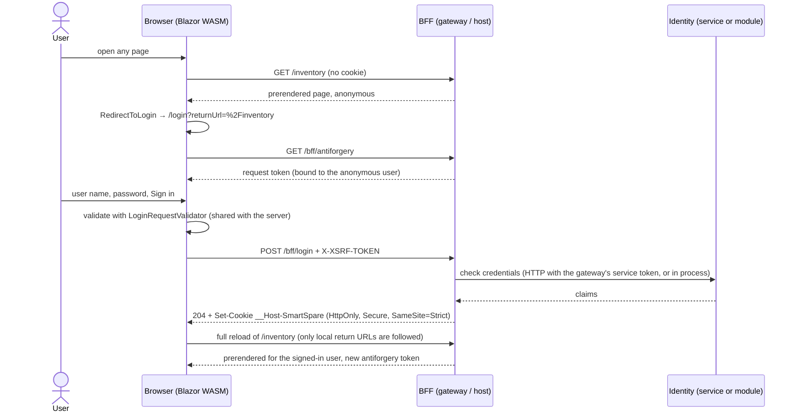
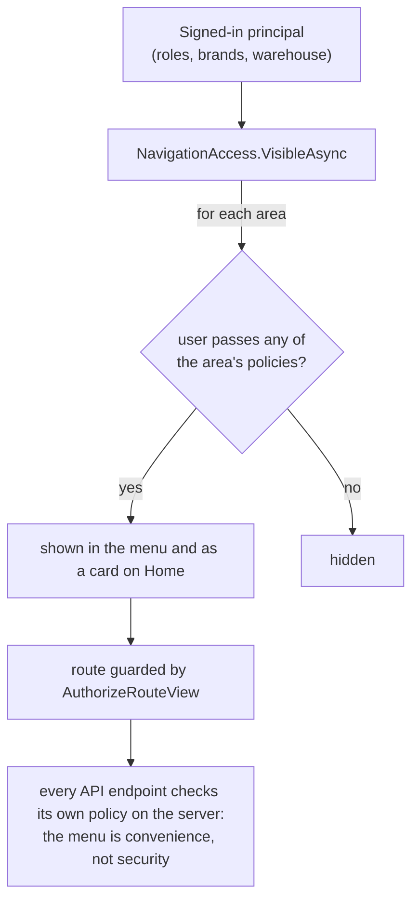
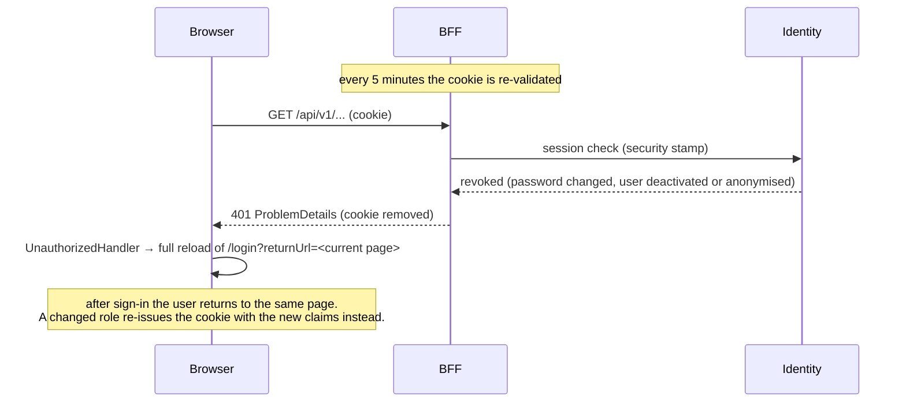
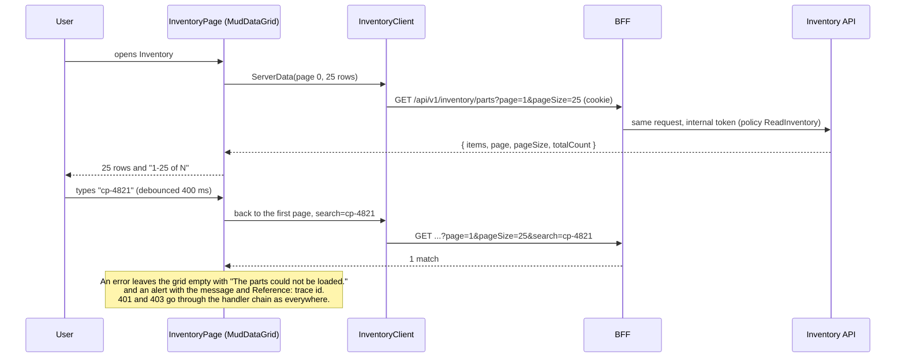
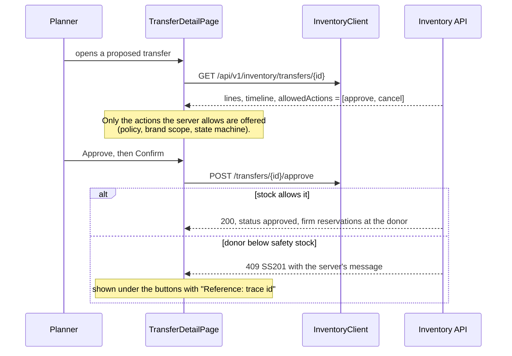

# SmartSpare — Front-end

The web client of SmartSpare: what it is built with and why, how it is structured, how the main user flows work, and how
it is tested. Decisions: [ADR 0006](../adr/0006-frontend-blazor-wasm-mudblazor-bff.md) (Blazor WebAssembly, MudBlazor,
BFF) and [ADR 0014](../adr/0014-browser-sign-in-through-bff-endpoints.md) (sign-in through BFF endpoints). Status as of
stage 6: the shell, sign-in, role-based navigation and error handling, the Inventory screens (stage 5) and the Fleet
screens for the service engineer's tablet (stage 6) are done. Procurement, Forecasting and Reporting come with their
modules in stages 7–9.

## 1. Stack and why

| Choice | Why | Decision |
|---|---|---|
| **Blazor WebAssembly** (.NET 10, Blazor Web App template with global InteractiveWebAssembly and prerendering) | One language and one toolchain with the back-end. DTOs and validators are shared with the server through `SmartSpare.ApiContracts`. The UI runs in the browser, so no server state and no SignalR circuit, which keeps the services stateless and scalable to zero | [ADR 0006](../adr/0006-frontend-blazor-wasm-mudblazor-bff.md) |
| **MudBlazor 9** | Material components for a data-heavy admin UI (tables, forms, dialogs, snackbars), MIT, supports .NET 10 | [ADR 0006](../adr/0006-frontend-blazor-wasm-mudblazor-bff.md) |
| **BFF with an HttpOnly cookie** | No token ever reaches the browser, so an XSS can't steal one. The gateway (production) or the single host (development) owns the cookie and calls the services | [ADR 0014](../adr/0014-browser-sign-in-through-bff-endpoints.md), [ADR 0016](../adr/0016-authentication-behind-the-gateway.md) |
| **Strict CSP** | `script-src 'self' 'wasm-unsafe-eval'` plus the hash of the inline import map; no `unsafe-inline` scripts. `style-src` allows inline styles because MudBlazor computes them (accepted in ADR 0014) | `SecurityHeaders` in [`WebClientHosting.cs`](../../src/BuildingBlocks/SmartSpare.Bff/WebClientHosting.cs) |

Rejected, with reasons in ADR 0006: Fluent UI Blazor (fewer data components), Telerik, DevExpress and Syncfusion (paid),
and InteractiveServer and Auto render modes (server state and SignalR hinder scaling and splitting into services).

## 2. Component structure

[`src/Web/SmartSpare.Web.Client`](../../src/Web/SmartSpare.Web.Client) references only `SmartSpare.ApiContracts`, never a
module (architecture test `WebClient_ReferencesOnlyApiContracts`).

```
SmartSpare.Web.Client/
  Routes.razor              router: AuthorizeRouteView, redirect of anonymous users, "not authorized" message
  Program.cs, ClientServices.cs   services: MudBlazor, localization, policies, typed API clients with their handlers
  Layout/
    MainLayout.razor        app bar (menu button, title, user menu), responsive drawer, content container
    LoginLayout.razor       narrow centred layout of the sign-in page
    NavMenu.razor           the menu: areas the user's policies allow (NavigationAreas)
    NavigationAreas.cs      areas, their icons and the policies that show them
    SmartSpareTheme.cs      colours and typography (WCAG 2.1 AA contrast)
  Features/                 one folder per module, like the back-end
    Home/Home.razor         welcome and a card per visible area
    Identity/               Login.razor + LoginForm.cs, UserMenu.razor (sign-out, change password), UsersPage.razor (user
                            administration), ChangePasswordPage.razor, IdentityClient.cs
    Inventory/              InventoryTabs.razor (Parts, Stock, Transfers, Import by policy); InventoryPage.razor (parts
                            catalogue); StockPage.razor, StockPositionPage.razor; TransfersPage.razor,
                            TransferDetailPage.razor, NewTransferPage.razor; ImportsPage.razor; status chips;
                            InventoryClient.cs
    Fleet/                  FleetTabs.razor (Machines, Due maintenance, Service orders); MachinesPage.razor,
                            MachinePage.razor (the machine card, WF03) with EngineHoursEntry.razor;
                            DueMaintenancePage.razor; ServiceOrdersPage.razor, ServiceOrderPage.razor,
                            NewServiceOrderPage.razor; due, order and kit status chips; EngineHoursInput.cs and
                            KitRefresh.cs (pure rules); FleetClient.cs
    Procurement/ Forecasting/ Reporting/   area pages (placeholders until stages 7–9)
  Shared/                   reusable components
    StatusChip.razor        a status as icon + text, never colour alone
    RedirectToLogin.razor   full navigation to /login?returnUrl=...
    NotFound.razor
  Http/                     the API layer
    ApiResult.cs            ApiResult<T> and ProblemInfo: a response is a value or a ProblemDetails, never an exception
    Handlers.cs             AntiforgeryHandler, UnauthorizedHandler, LoginLinks (safe return URLs)
    ProblemMessages.cs      ProblemDetails code → readable, localized message with "Reference: <trace id>"
  Resources/SharedResource.resx   every UI string (IStringLocalizer)
```

**API services.** Each module gets one typed client, `<Module>Client`, which calls only relative URLs. Today there are
two:
- `IdentityClient` for `/bff/login`, `/bff/logout`, `/bff/me`, `/api/v1/identity/users/...` and `/api/v1/identity/me/password`;
- `InventoryClient` for `/api/v1/inventory/parts`, `/warehouses`, `/stock`, `/stock-adjustments`, `/transfers` and `/imports`.

The clients share one handler chain, built per DI scope in `ClientServices.CreateHttpClient`:



**State.** Plain scoped services and the cascading `AuthenticationState`; no Fluxor or Redux (ARCHITECTURE_DECISIONS §6).
The server prerenders the page and hands the browser an allow-listed principal: user id, name, roles, brands and
warehouse, never the security stamp (`ClientAuthenticationState`).

## 3. User flows

### 3.1 Sign-in



### 3.2 Wrong password, with a reference

```mermaid
sequenceDiagram
  actor U as User
  participant B as Browser
  participant F as BFF
  U->>B: wrong password, Sign in
  B->>F: POST /bff/login
  F-->>B: 400 ProblemDetails { code: SS-AUTH-001, traceId }
  B->>B: ProblemMessages: "The user name or password is incorrect. Reference: 4bf9…0e47"
  B-->>U: error alert under the form (role=alert)
  Note over U,F: Every failure (unknown user, wrong password, locked, inactive) gives the same message.<br/>The reference is the W3C trace id; operations find the request with it (TRACING.md).
```

### 3.3 Role-based navigation



The policies come from `SmartSpare.ApiContracts` (`AppPolicies`), the same definitions the server enforces. Inventory
and Fleet are shown by their read policies, `ReadInventory` and `ReadFleet`, which every role has. The other areas
are shown by their action policies until their read policies arrive with stages 7–9. The bUnit test
`The_menu_shows_the_areas_the_roles_may_work_in` checks every role.

### 3.4 Session expiry and 401



A 403 keeps the user on the page and shows "You are not allowed to do this." with the reference in a snackbar.

### 3.5 Sign-out

```mermaid
sequenceDiagram
  actor U as User
  participant B as Browser
  participant F as BFF
  U->>B: user menu → Sign out
  B->>F: POST /bff/logout + X-XSRF-TOKEN
  F-->>B: 204, cookie deleted
  B->>B: full reload of /login
  Note over B: the prerendered page is anonymous again;<br/>GET /bff/me answers isAuthenticated: false
```

### 3.6 Browsing the parts catalogue



### 3.7 Approving a transfer (stage 5)



### 3.8 Logging engine hours and following the kit (stage 6)

```mermaid
sequenceDiagram
  participant E as Service engineer
  participant M as MachinePage + EngineHoursEntry
  participant O as ServiceOrderPage
  participant F as Fleet API
  participant I as Inventory (events)
  E->>M: Log engine hours (decimal keypad)
  Note over M: EngineHoursInput checks first: a number, at most one decimal,<br/>not below the last reading, not before it, not in the future
  M->>F: POST /machines/{id}/readings (time fixed per attempt)
  alt a rule is broken on the server
    F-->>M: 422 SS100–SS104
    Note over M: a plain sentence from the resources, never the code,<br/>with "Reference: trace id"; focus back on the field
  else stored
    F-->>M: 201, the orders the reading drafted
    F->>I: ServiceOrderDrafted (outbox)
  end
  E->>O: opens the drafted order
  O-->>E: kit "Reserving parts…" (polite live region)
  loop every 2 s, at most 30 s (KitRefresh)
    O->>F: GET /service-orders/{id}
  end
  I-->>F: ServiceKitReserved
  O-->>E: "Kit reserved"; Start, Complete, Cancel from allowedActions
```

A retry after a lost answer sends the identical reading (same time and hours), which the server answers as a replay
instead of storing it twice. A 409 on an order shows the server's sentence and reloads the order, so the screen shows
the state it moved to. If the hub never answers, the page stops asking after 30 seconds and says so.

## 4. Forms and validation

- Form models (`LoginForm`) convert to the API request (`LoginRequest`) and are validated with the **same
  FluentValidation validator** the server uses, from `SmartSpare.ApiContracts`. The rules can't drift apart, and the
  server validates again: the client's check is for the user, not for security.
- `MudForm` validates per field as the user types (`Immediate`, `ValidationDelay = 0`). Submit validates the whole
  form and sends nothing when it is invalid (bUnit `Empty_fields_show_the_shared_validator_messages_and_send_nothing`).
- Inputs carry `autocomplete` hints (`username`, `current-password`) so password managers work.

## 5. Error handling

| Response | What the user sees | Where |
|---|---|---|
| 400 with a known `code` (`SS-AUTH-001`, `SS-AUTH-002`, …) | A specific, localized message with "Reference: \<trace id\>" | `ProblemMessages` |
| 400/404/409/422 business error | The server's `detail` with the reference | `ProblemMessages` |
| 401 | Full reload to the sign-in page with the current page as return URL | `UnauthorizedHandler` |
| 403 | Snackbar "not allowed" with the reference; the page stays | `UnauthorizedHandler` |
| 429 | "Too many attempts. Wait a minute and try again." | `ProblemMessages` |
| 500/503 | A generic message with the reference, never internal details | `ProblemMessages` |

Responses are values (`ApiResult<T>`), not exceptions, so a page always decides what to show. The reference is the W3C
trace id the server puts into every ProblemDetails (#60); [TRACING.md](../operations/TRACING.md) follows it to the logs
and the trace.

## 6. Loading states

- **Before WebAssembly runs**, the server-prerendered page is visible at once. Interactive elements expose
  `data-interactive="true"` once the client has taken over, which the end-to-end tests wait for.
- **Sign-in page:** a progress bar while it checks for an existing session (`/bff/me`), and a busy, disabled button
  with a spinner while signing in (bUnit `While_signing_in_the_button_is_busy_and_disabled`), so there is no double
  submit.
- **Business pages:** the grid's loading row ("Loading parts…") while the server answers, and an empty state when
  nothing matches ("No parts match the search.") or the call failed (bUnit
  `While_the_server_answers_the_grid_shows_that_parts_are_loading`). Prerendering doesn't call the API; the grid loads
  once WebAssembly runs and the session cookie can be used. Later pages follow the same convention.
- **Cold start** (production scales to zero): the gateway's `/warmup` wakes the services before a session (STAGE_4_PLAN
  8.7).

## 7. Responsive layout

- MudBlazor's breakpoints: `MudContainer` widths, `MudGrid` items that stack on small screens. The drawer is
  *responsive*: docked beside the content on wide screens, an overlay opened from the app bar's menu button on phones.
- The sign-in page uses a narrow centred layout (`LoginLayout`) that fits a phone.
- **Checked on a phone viewport:** Playwright `MobileLayoutTest` at 390 × 844 (touch, 3× scale). The sign-in page,
  the home page and the Inventory page with the parts grid loaded have no horizontal scroll, and the menu opens from
  the app bar and leads to an area. On a phone the grid shows each part as a stacked card (`Breakpoint.Sm`).
  Screenshots are in `TestResults/e2e/mobile-*.png`.
- **The engineer's tablet** (stage 6): the machine card (WF03) and the order detail keep their main action at the
  bottom of the screen below the md breakpoint (`bottom-action`), touch targets are at least 44 px (`touch-target`),
  tables that would be too wide fold into two or three columns, and the Fleet tabs wrap. Playwright
  `FleetScenarioTest` runs the whole service scenario at 1280 × 800, 820 × 1180 and 390 × 844 and fails if a page
  scrolls sideways.

**Accessibility** (WCAG 2.1 AA target): ARIA labels on icon buttons, real labels on every field, a visible focus
outline for keyboard focus (`:root :focus-visible`, which also beats MudBlazor's own `outline: none` on buttons), focus
moved to the page heading on navigation (`FocusOnNavigate`, `tabindex="-1"`) without a ring, because Tab never reaches
it (`:focus:not(:focus-visible)`, checked by the E2E scenario), colours with sufficient contrast, statuses shown as
icon + text, not colour alone (`StatusChip`, bUnit-tested), status filters as buttons with `aria-pressed`, and the kit
status of an order as a polite live region.

## 8. Tests

| Level | Project | What it covers |
|---|---|---|
| Components (bUnit) | [`tests/SmartSpare.Web.Tests`](../../tests/SmartSpare.Web.Tests) | Sign-in form: shared validator messages, busy state, the generic failure with its reference, return URL and open-redirect protection; menu per role; redirect to sign-in; 401 and 403 handling; antiforgery header on unsafe methods; problem messages; status chip; parts grid; stock overview and position (forms by role, `If-Match` version, conflict reload); transfers list, detail (exactly the allowed actions, confirmation, cancel reason, server refusals) and proposal form; import (report, row errors, refusals); user administration and own password change; Fleet: machine list and card,
engine-hours entry (decimal keypad, label, rules before sending, SS100–SS104 as sentences, identical retry), due list,
order list with status tabs, order detail (allowed actions, completion hours, cancel reason, conflict reload, kit
refresh and its time-out, shortfall), new-order form; the pure rules `EngineHoursInput` and `KitRefresh` |
| End-to-end (Playwright, Chromium) | [`tests/SmartSpare.E2E`](../../tests/SmartSpare.E2E) | `SignInSmokeTest`: redirect, wrong password with reference, sign-in, role menu, no credential readable by scripts, sign-out. `PartsCatalogueTest`: the demo catalogue page by page and a search. `MobileLayoutTest`: phone viewport with the parts grid. `ApiReferenceTest`: `/scalar` under its CSP. `StockScreensTest`: stock overview and position on desktop and phone. `TransferScenarioTest`: a planner proposes and approves a transfer and finds the donor's reservation; the list on a tablet. `ImportScreenTest`: a catalogue upload through the screen. `FleetScenarioTest`: an engineer logs hours that make a service due, follows the kit until it is reserved, starts and completes the order and sees the kit issued, on desktop, tablet and phone, with the focus checks |
| Server side of the client | [`tests/SmartSpare.Host.IntegrationTests`](../../tests/SmartSpare.Host.IntegrationTests) | Cookie flags, antiforgery, CSP and the import-map hash, the principal handed to the client, rate limiting |

The bUnit tests run in the "Build and test" CI job and the Playwright tests in the "End-to-end smoke test" job (`tools/check.sh e2e`, real host on Kestrel, PostgreSQL in Testcontainers, demo data, headless Chromium).
