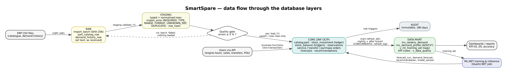
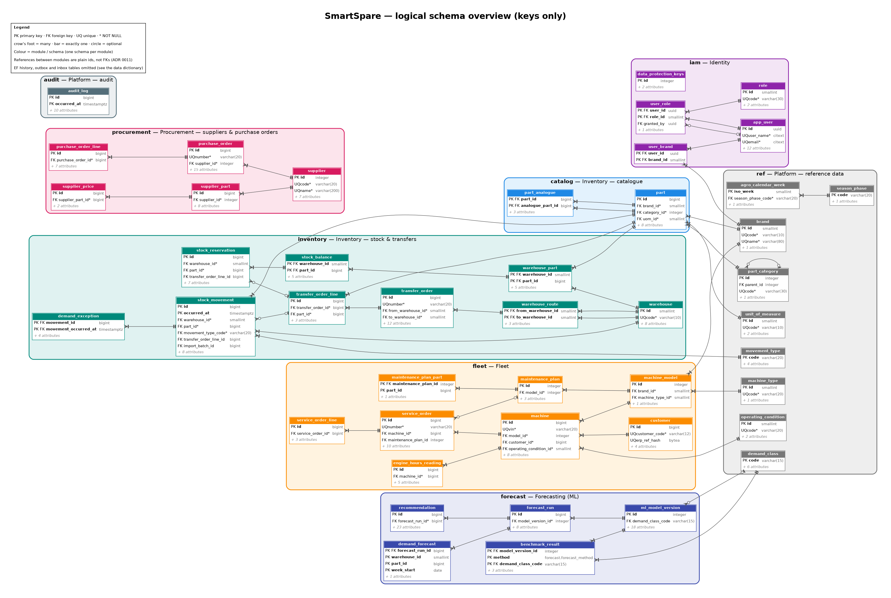

# SmartSpare — Database Design (Transactional / OLTP)

**Diploma project:** *System for Agricultural Machinery Maintenance Planning and Spare Parts Demand Forecasting Using Machine Learning* (SmartSpare)
**Author:** Sergei Gorgun · **DBMS:** PostgreSQL 17 (Azure Database for PostgreSQL Flexible Server; tested on postgres:17 locally and in CI) · **Access layer:** EF Core 10 + Npgsql, hybrid code-first migrations per module (ADR 0004, ADR 0011)

Companion documents: [Data dictionary](DATA_DICTIONARY.md) (generated) · [Architecture](../architecture/ARCHITECTURE_DECISIONS.md) · DDL: [`db/ddl/smartspare_schema.sql`](../../db/ddl/smartspare_schema.sql) · Diagrams: [`diagrams/`](diagrams/)

---

## 0. Requirements compliance matrix

The database is submitted in the **Transactional databases (OLTP)** category. Every item of the grading rubric is mapped to the evidence in the repository.

### Minimum requirements (5 points)

| Requirement | Evidence |
|---|---|
| Data dictionary: layers, tables, columns, types, keys, data-quality expectations | [DATA_DICTIONARY.md](DATA_DICTIONARY.md) — generated from the catalogue of the EF-built database: 85 relations (51 business tables, 7 EF history and 10 outbox/inbox tables, 15 views, 2 materialised views), every column with type, PK/FK/UQ/NN flags, comment, all CHECK/EXCLUDE rules as "data quality expectations", indexes, triggers, 60 routines |
| How integrity is maintained and transactions are handled | §5 and §6 of this document |
| ER diagram (optional) / logical schema with main blocks, colour coding | [diagrams/logical_schema_overview.svg](diagrams/logical_schema_overview.svg) (keys), [logical_schema_core.svg](diagrams/logical_schema_core.svg) (all columns), [logical_schema_import_layers.svg](diagrams/logical_schema_import_layers.svg); one colour per module, crow's-foot notation, legend. **Editable:** draw.io files (`*.drawio`, all pages in [`docs/SmartSpare_diagrams.drawio`](../SmartSpare_diagrams.drawio)) and the schema as code in DBML ([`diagrams/smartspare_core.dbml`](diagrams/smartspare_core.dbml), dbdiagram.io) |
| DDL script | [`db/ddl/smartspare_schema.sql`](../../db/ddl/smartspare_schema.sql) (complete, generated from the EF-built database); the versioned EF Core migrations of each module (`src/Modules/*/Infrastructure/Persistence/Migrations`, Platform in `src/BuildingBlocks/SmartSpare.Infrastructure`) with their SQL parts in [`db/sql/`](../../db/sql) |
| Modern relational DBMS | PostgreSQL 17 on Azure (§1) |
| 3NF | §4.2 — every table in 3NF; four deliberate, trigger-maintained redundancies are listed and justified |
| Enough tables, different relationship types | 43 core tables + 8 import, mart and utility tables; 1:1, 1:N, M:N (with and without attributes), recursive, ternary (§4.1) |
| PK, FK, constraints, meaningful types | 100 % of tables have a PK; 115 FKs (the 33 that crossed module boundaries were removed by ADR 0011, those references are plain ids); 146 CHECK constraints on business tables; `numeric` for money and quantities, `timestamptz` for time, `daterange`, `citext`, `uuid`, ENUMs (§4.3) |
| Structure created by scripts/migrations, not manually; in Git | `db/bootstrap` (roles, database) + EF Core migrations per module with SQL parts in `db/sql/`, applied by `SmartSpare.MigrationRunner` locally, in CI and, as a Container Apps job, on Azure (§9, ADR 0020) |
| Test data incl. edge cases; scripts for reference tables | Reference data: seed parts of the migrations ([`db/sql/platform/seed_ref.sql`](../../db/sql/platform/seed_ref.sql), [`identity/seed_roles.sql`](../../db/sql/identity/seed_roles.sql), [`inventory/seed_warehouses.sql`](../../db/sql/inventory/seed_warehouses.sql)). Test data: [`db/testdata/T001__demo_dataset.sql`](../../db/testdata/T001__demo_dataset.sql) (deterministic, ~200k ledger rows, invalid/duplicate import rows). Tests: 97 assertions + concurrency test, run in CI on the EF-built database (§10) |
| Roles app_read, app_write, admin; app not superuser; permissions checked for new objects | Roles `app_read`, `app_write`, `app_ml`, `app_audit`, `app_admin` + 4 login roles; none is superuser; default privileges + automatic self-check view `util.v_privilege_findings` run by the tests (§8) |
| Passwords only hashed, no outdated methods | Application users: ASP.NET Core Identity V3 (PBKDF2-HMAC-SHA512, 220,000 iterations — the OWASP value — 128-bit salt; older 100,000-iteration hashes are rehashed at sign-in), format enforced by a CHECK that rejects plain text, MD5 and SHA digests. DB logins: SCRAM-SHA-256 (§8.4) |
| Integrity via constraints and transactions | §5, §6 |
| Restrictions: no plain-text passwords, no CSV-only storage, no unstructured JSON without a model, no ignored integrity | Satisfied; the only two `jsonb` columns are justified, typed by CHECK (`jsonb_typeof = 'object'`) and documented (§4.4) |

### Maximum requirements (10 points)

| Requirement | Evidence |
|---|---|
| Different DBMS types if the topic justifies it — reasoning | §1.2: evaluated (ClickHouse, Redis, MongoDB) and **deliberately rejected** with quantitative reasons; analytics is served by a data-mart layer inside PostgreSQL |
| Data layers raw → staging → data mart — reasoning | §3: `raw` → `staging` → core → `mart`, with quality gate, deduplication and load monitoring |
| Structure versioning: how changes are tracked, history stored | §9: forward-only EF Core migrations per module, history table `<schema>.__ef_migrations_history` per context, model-drift check in CI, schema diff against the frozen V016 baseline, Git workflow |
| Indexes implemented and justified | §7: every index with its query and reason; plans verified by `db/tests/T04`; timings at 20,000 SKUs |
| Triggers, stored procedures, functions implementing business logic | §6: 17 trigger functions on 47 triggers, 60 routines in total incl. 4 procedures (stock ledger, reservations, transfer workflow, engine-hours validation, maintenance due calculation, MOQ rules, four-eyes approval, model promotion, import pipeline, retention) |
| Views / materialized views | §6.4: 15 views + 2 materialised views (concurrent refresh, refresh log) |
| Masking / anonymisation of personal data | §8.5: column privileges + masking functions/views, HMAC pseudonymisation of customers, GDPR erasure function, PII excluded from audit |

---

## 1. Choice of the DBMS

### 1.1 Why a relational OLTP database

SmartSpare is first of all a **transaction-processing system**: stock reservations, transfers between 7 warehouses, purchase orders with approval, service orders and engine-hour readings. The BA requirements make consistency non-negotiable — NFR03 demands *"zero duplicate allocations or negative stock balances … 100 % atomic rollbacks"*, US18 an immutable audit trail, US14 a four-eyes approval rule. These are ACID properties, rich constraints and row-level locking — the strengths of a relational DBMS. The data are highly structured and strongly related (part ↔ supplier ↔ warehouse ↔ machine model ↔ maintenance kit), which favours a normalised relational model over documents or graphs.

PostgreSQL was chosen because it is the DBMS fixed in the diploma application, is natively offered as a managed service in Azure (NFR07 budget ≤ €35/month), and provides the features this design relies on: declarative partitioning, `EXCLUDE` constraints, generated columns, materialised views with concurrent refresh, `SECURITY DEFINER` functions, column-level privileges, trigram indexes and SCRAM authentication. Npgsql gives EF Core first-class support for its ENUMs and for `xmin` as a concurrency token.

### 1.2 Why one DBMS and not "PostgreSQL + ClickHouse/Redis/MongoDB"

The rubric allows several DBMS *"if the topic justifies it"*. The alternatives were evaluated and rejected deliberately:

| Candidate | Would serve | Why rejected |
|---|---|---|
| ClickHouse (OLAP) | demand history aggregation, KPIs | Data volume is small for OLAP: 20,000 SKUs × 7 hubs × 104 weeks ≈ 2 M weekly cells; measured aggregation of the full mart at the BA scale takes seconds in PostgreSQL (§7.3). A second engine would require CDC/ETL, a second backup strategy and a second managed service (Azure has no managed ClickHouse; ≥ €100/month), violating NFR07 (≤ €35/month) for no measurable gain. |
| Redis (cache) | hot stock look-ups | NFR01 (p95 ≤ 2 s) is met by indexed primary-key look-ups (< 1 ms); a cache would introduce stale stock — the exact failure the system must prevent (NFR03). |
| MongoDB (documents) | ML hyper-parameters, audit payloads | Only two semi-structured attributes exist; they are stored as typed `jsonb` inside the relational model (§4.4). |

Instead, the **analytical workload is isolated in a data-mart layer inside PostgreSQL** (§3). If the dealer network grew by an order of magnitude, the `mart` schema is the seam where an external analytical store could be attached without touching the OLTP core.

---

## 2. Database architecture at a glance



* **One database, schemas owned by modules** of the modular monolith (ADR 0011): Platform `ref`, `util`, `audit`; Identity `iam`; Inventory `catalog`, `inventory`, `raw`, `staging`; Fleet `fleet`; Procurement `procurement` (including the suppliers); Forecasting `forecast`; Reporting `mart`. Each module has its own DbContext and migration history. There are **no foreign keys, JOINs or transactions across modules**: a reference to another module is a plain id, and state changes between modules travel as integration events through each module's `outbox_message` / `inbox_message`. Foreign keys to the Platform's `ref` tables are kept (shared kernel). Reporting reads other schemas through views and materialised views, the one documented exception. Objects that still cross modules until their module stage replaces them are marked TRANSITIONAL ([MODULE_MAPPING](MODULE_MAPPING.md) §3.2).
* **Data layers** `raw` → `staging` → core → `mart` for imported and analytical data (§3).
* **Business-critical logic lives next to the data** (triggers and functions), so it is enforced for every client — the API, background jobs, imports and manual SQL alike.

Statistics (EF-built database, all migrations of stage 2): 12 schemas · 51 business tables (2 partitioned: 61 + 49 monthly partitions, created relative to the build date) + 7 EF history and 10 outbox/inbox tables · 15 views · 2 materialised views · 115 foreign keys, none across modules · 146 CHECK constraints on business tables (+ 10 on outbox/inbox) · 1 EXCLUDE constraint · 13 ENUM types · 60 functions/procedures · 17 trigger functions on 47 triggers (19 tables audited).

### 2.1 Data access layer

| Where | What |
|---|---|
| `src/BuildingBlocks/SmartSpare.Infrastructure/Persistence/` | Shared plumbing: unit of work (`IUnitOfWork<TContext>`, `EfUnitOfWork`, writes the outbox in the same `SaveChanges`), session context (`SessionContextInterceptor` sets `app.user_id` and friends per transaction), error mapping (`DatabaseErrorMapper`, SQLSTATE SS1xx–SS4xx → ProblemDetails), SQL resource helper (`SqlResourceMigrationExtensions`, applies the embedded `db/sql` files from a migration), `IModuleDatabase` and the Npgsql/EF registration, and the Platform context (`Platform/PlatformDbContext`: `ref`, `util`, `audit`) |
| `src/Modules/<Module>/…/Infrastructure/Persistence/` | Owned by each module: its `DbContext`, `Configurations/` (Fluent API per table), `Migrations/` (history in `<schema>.__ef_migrations_history`) and, until its module stage, the stage 2 table mirrors in `PersistenceModel.cs` (Identity maps its domain aggregates directly since stage 3, ADR 0013) |
| `db/sql/<module>/` | The SQL parts of that module's migrations: triggers, functions, views, partitions, grants, seed data (ADR 0004) |
| `src/Bootstrapper/SmartSpare.MigrationRunner`, `SmartSpare.ModuleCatalog` | The catalogue lists every module database in migration order (shared with the host); the runner bootstraps the server and applies the migrations locally and in CI, and runs `check-model` |

There is **no single data-access project** on purpose: each module owns its schema, its DbContext and its migrations (ADR 0002, ADR 0011), so a module can be extracted with its data and nothing else has to change. Only the cross-cutting plumbing is shared through BuildingBlocks. Inside a module, EF Core maps the domain aggregates directly. There is no generic repository and no separate persistence model once the module stage is done ([ADR 0013](../adr/0013-domain-model-and-persistence.md)).

---

## 3. Data layers (raw → staging → core → data mart)

| Layer | Schema | Purpose | Written by | Read by |
|---|---|---|---|---|
| 1. Raw | `raw` | Exact copy of an uploaded CSV file: all columns as `text`, file name, SHA-256, uploader. Nothing is lost even if the data are invalid; batches can be re-processed. | API (COPY / binary import) | staging functions |
| 2. Staging | `staging` | Typed, normalised (trim, upper-case OEM numbers, decimal comma), validated rows; each defect recorded in `staging.import_error` with a code (REQUIRED, TYPE, RANGE, FORMAT, UNKNOWN_REF, DUPLICATE). | `staging.validate_*()` | load functions, UI error report |
| 3. Core (OLTP) | `ref` … `audit` | 3NF transactional model, the single source of truth. | API, jobs, load functions | everything |
| 4. Data mart | `mart` | Denormalised read models: weekly demand per SKU/hub, demand classification (ADI/CV²), dense ML training set with lag features, KPI views, data-quality checks. | `mart.refresh_all()` | ML.NET training, dashboards |

**Why the layers are needed for this topic.** (1) The BA's transition plan (Appendix C.2) migrates the SKU catalogue and two years of demand history from the legacy ERP as CSV files — real exports contain wrong dates, unknown SKUs and duplicates, so raw data must be kept and validated before touching the core. (2) The ML pipeline (US07) needs weekly, zero-filled, feature-engineered series — computing them on the fly from the ledger on every training run would compete with the OLTP workload, so they are materialised once per night.

**Load rules.**
* *Catalogue:* full upsert by natural key (brand + OEM number); only rows whose values actually change are updated (no audit noise).
* *Demand history:* **incremental** — a business hash (`date | hub | part | document | qty`, SHA-256) marks rows already loaded by an earlier batch as duplicates; only new rows are inserted into the ledger.
* *Same file twice:* rejected by `UNIQUE (source, file_sha256)`.
* *Quality gate:* if more than 5 % of the rows are invalid, the batch is marked `failed` and **nothing** is loaded (all-or-nothing, one transaction); otherwise valid rows are loaded and the errors are reported.
* *Monitoring:* `raw.import_batch` (row counts, error rate, duration) → `mart.v_import_monitor`; mart refreshes → `mart.refresh_log`; reconciliation → `mart.v_data_quality`.

Demonstrated by the test data: a 186,659-row history file (loaded), a correction file with 150 duplicates + 10 invalid rows (40 loaded, 10 reported, 150 skipped) and a catalogue file with 7.9 % errors (rejected as a whole).

---

## 4. Logical model

The logical schema is shown in [diagrams/logical_schema_overview.svg](diagrams/logical_schema_overview.svg) (keys only) and [diagrams/logical_schema_core.svg](diagrams/logical_schema_core.svg) (all attributes). Colours = modules.



### 4.1 Main entities and relationship types

| Module | Tables | Notes |
|---|---|---|
| Reference | unit_of_measure, brand, machine_type, part_category, operating_condition, movement_type, demand_class, season_phase, agro_calendar_week | fixed data, seeded by R001 |
| IAM | app_user, role, user_role, user_brand | RBAC; brand managers own brands |
| Catalogue | part, part_analogue, supplier, supplier_part, supplier_price | US03, US12, US15 |
| Inventory | warehouse, warehouse_route, warehouse_part, stock_balance, stock_movement, demand_exception, stock_reservation, transfer_order, transfer_order_line | ledger-based stock |
| Fleet & maintenance | customer, machine_model, machine, engine_hours_reading, maintenance_plan, maintenance_plan_part, service_order, service_order_line | US01–US06 |
| Procurement | purchase_order, purchase_order_line | US13, US14, US16 |
| Forecasting | ml_model_version, benchmark_result, forecast_run, demand_forecast, recommendation | US07–US10, NFR08 |
| Audit | audit_log | US18 |

| Relationship type | Examples |
|---|---|
| 1 : N (mandatory) | brand → part, machine → engine_hours_reading, transfer_order → transfer_order_line |
| 1 : N (optional) | maintenance_plan → service_order (NULL = unplanned repair), app_user → warehouse (home hub) |
| 1 : 1 | stock_movement ↔ demand_exception (shared primary key) |
| M : N without attributes | app_user ↔ role (`user_role`), app_user ↔ brand (`user_brand`) |
| M : N with attributes | supplier ↔ part (`supplier_part`: MOQ, pack size, lead time), maintenance_plan ↔ part (`maintenance_plan_part`: quantity = service kit) |
| Recursive (self-referencing) | part_category.parent_id (tree), part ↔ part (`part_analogue`), warehouse ↔ warehouse (`warehouse_route`) |
| Ternary | demand_forecast (forecast_run × warehouse × part, per week) |
| Composite FK | stock_balance → warehouse_part, transfer_order → warehouse_route (a transfer is only possible along a known route), demand_exception → stock_movement (id, occurred_at) |

### 4.2 Normalisation (3NF)

All tables are in 3NF: attributes depend on the whole key and only on the key. Typical decisions:

* **Stocking policy separated from stock state** — `warehouse_part` (bin location, safety stock: changed rarely by planners) vs. `stock_balance` (on hand, reserved: changed by every movement). Both depend on (warehouse, part), but they have different writers, privileges and update rates.
* **Prices with validity periods** in `supplier_price` instead of a price column on `supplier_part` (a price depends on the supplier-part *and* the period).
* **Customer** stores no personal data at all (pseudonymised, §8.5).
* Look-ups are separate tables (brand, category, condition, movement type …), status workflows are ENUMs (fixed by code).

**Controlled redundancy (deliberate, documented, maintained by the DBMS):**

| Redundant value | Derived from | Why stored | Kept consistent by |
|---|---|---|---|
| `stock_balance.on_hand_qty`, `reserved_qty` | SUM of the ledger / active reservations | O(1) stock look-ups for 140k SKU-hub pairs (NFR01), row to lock for concurrency control | triggers on `stock_movement` and `stock_reservation`; reconciled by `mart.v_data_quality` |
| `stock_balance.available_qty`, `purchase_order_line.line_amount` | other columns of the same row | convenience | `GENERATED ALWAYS … STORED` — cannot become inconsistent |
| `purchase_order.total_amount` | SUM(line_amount) | needed by the four-eyes CHECK constraint | trigger `trg_po_line_total`; reconciled |
| `machine.current_engine_hours` | last reading | machine card, maintenance calculation | trigger `trg_engine_hours_apply`; reconciled |

### 4.3 Data types policy

| Kind of data | Type | Reason |
|---|---|---|
| Money | `numeric(12,2)`, totals `numeric(14,2)` | exact decimal arithmetic, never `float` |
| Quantities | `numeric(12,3)` | litres of oil are fractional; unit of measure decides |
| Engine hours | `numeric(8,1)` | odometers show tenths of hours |
| Points in time | `timestamptz` | unambiguous across DST; Europe/Vilnius used for business weeks |
| Calendar dates, validity | `date`, `daterange` | price periods with `EXCLUDE` |
| Identifiers | `bigint`/`integer`/`smallint` identity; `uuid` for users | size per expected volume; user ids travel outside `iam` (sign-in claims, `app.user_id`, the audit trail, plain-id references in other modules), so they are globally unique rather than sequential |
| E-mail, user name | `citext` | case-insensitive uniqueness |
| Codes | `varchar(n)` + regex CHECK | format validation in the DB |
| Status | PostgreSQL ENUM | 4 bytes, mapped to C# enums by Npgsql |
| Hashes | `bytea` (HMAC) / `char(64)` (hex SHA-256) | fixed length, checked |

### 4.4 The two `jsonb` columns (justified)

Unstructured JSON is avoided. Exactly two columns use `jsonb`, both with a CHECK `jsonb_typeof(...) = 'object'`:
* `forecast.ml_model_version.hyperparameters` — the key set differs per algorithm (FastTree: trees/leaves/learning rate; SES: alpha; Croston: alpha/beta). The values are stored and displayed as a whole, never filtered or joined; a column per hyper-parameter of every algorithm would produce mostly NULL columns.
* `audit.audit_log.old_values / new_values` — one generic audit table for 19 audited tables with different column sets; values are only displayed. Personal-data columns are excluded before writing.

---

## 5. Integrity

| Mechanism | Used for (examples) |
|---|---|
| PRIMARY KEY on every table | surrogate identity keys; natural composite keys for association tables |
| UNIQUE (incl. partial / expression) | VIN, e-mail, brand + OEM number; *one preferred supplier per part*; *one active ML model per scope*; *one non-cancelled service order per machine, plan and due threshold* (idempotent engine-hour logging); *one central hub* |
| FOREIGN KEY with explicit actions | `CASCADE` for owned children (order lines), `RESTRICT` for master data, `SET NULL` for "who" columns |
| CHECK | ranges and formats; cross-column rules (reserved ≤ on hand, MOQ multiple of pack size, holdout after training, override requires a reason, timestamps in order); state consistency (`status = 'received'` ⇔ `received_at IS NOT NULL`); **NFR08 explanation must add up** (`net = available + in transit − (a+b+c+d)`); **four-eyes rule** (approver ≠ author above €5,000); password hash format |
| EXCLUDE (GiST) | no overlapping price periods per supplier-part |
| NOT NULL | everywhere a value is mandatory (marked NN in the data dictionary) |
| Triggers | ledger → balance, reservation sums, odometer monotonicity and plausibility, state machines, PO line rules, append-only tables, audit |
| Privileges | derived tables (`stock_balance`, `stock_reservation`) cannot be written by application roles at all |
| Reconciliation | `mart.v_data_quality`: ledger vs. balance, reservations, PO totals, odometer, duplicates — all 0 on the test data |

**State machines** (transfer orders, purchase orders, service orders, reservations, ML models) are guarded by `BEFORE UPDATE` triggers that allow only the documented transitions, e.g. transfer: `proposed → approved → dispatched → received`, `proposed|approved → cancelled`.

**Append-only data**: the stock ledger, engine-hour readings and the audit log reject `UPDATE`/`DELETE` by trigger — even for the owner. Errors are corrected with compensating movements.

## 6. Transactions, concurrency and business logic in the database

### 6.1 Transactions

* Every business operation **inside a module** is one database transaction: e.g. `inventory.approve_transfer()` reserves all lines or none; `staging.process_batch()` validates and loads a whole file or nothing. Operations that span modules (UC01 recommendation → transfer, UC02 service order → kit reservation) become integration-event flows with eventual consistency and compensating actions (ADR 0003, ADR 0011); until their module stage, `fleet.log_engine_hours()` and `forecast.decide_recommendation()` still run them in one transaction as marked TRANSITIONAL functions.
* The API runs every command inside a transaction of the owning module's DbContext (transaction decorator, ADR 0005; MODULE_MAPPING §5.6): EF Core's `SaveChanges`, the SQL functions it calls and the module's outbox rows share it, so data changes and the events they raise are committed together or not at all.
* Isolation level: **READ COMMITTED** (PostgreSQL default) combined with explicit row locks — sufficient because every invariant is protected by a lock on the row that carries it, and it avoids serialisation-failure retries under load.

### 6.2 Concurrency control

| Risk | Protection |
|---|---|
| Two sessions issue/reserve the same SKU at the same hub (lost update, negative stock — NFR03) | `SELECT … FOR UPDATE` on the `stock_balance` row inside the ledger and reservation triggers; CHECK `on_hand ≥ 0`, `reserved ≤ on_hand` as the last line of defence. Verified by `db/tests/concurrency_test.sh`: session B waits for A's lock, then sees the reduced stock and is rejected (SS200). |
| Deadlocks between multi-line operations | lines are always locked in the same order (`ORDER BY part_id`) |
| Concurrent readings of one machine | lock on the `machine` row in the reading trigger |
| Gaps / duplicates in document numbers | per-prefix-and-year counter row updated with `INSERT … ON CONFLICT DO UPDATE … RETURNING` (row lock, rolled back with the transaction) |
| Two users edit the same record in the UI (UC01 E1, risk R5) | optimistic concurrency in EF Core with PostgreSQL's `xmin` system column (`IsRowVersion()`), → HTTP 409 and the UI re-evaluates the proposal |
| Two deployment pipelines migrate at once | `pg_advisory_xact_lock` in the migrator |

### 6.3 Triggers, functions and procedures (business logic)

| Object | Kind | Business rule (BA reference) |
|---|---|---|
| `inventory.trg_stock_movement_apply` | trigger | posts every ledger movement to the balance with a row lock; rejects issues exceeding available stock (NFR03) |
| `inventory.trg_stock_reservation_guard` / `_sync` | triggers | reservation state machine; keeps `reserved_qty` = Σ active holds |
| `inventory.approve/dispatch/receive/cancel_transfer` | functions | UC01 steps 10–11, US10 (donor keeps safety stock), US11 (keeper of the right hub) |
| `inventory.expire_soft_reservations` | procedure | 7-day soft holds expire; service orders return to draft (Quartz job) |
| `inventory.find_exceptional_demand_candidates` / `flag_exceptional_demand` | functions | US08: demand lines above mean + 3σ (window functions) |
| `fleet.trg_engine_hours_validate` | trigger | UC02 A1 rollback (SS100), plausibility ≤ elapsed time (SS101) |
| `fleet.fn_maintenance_due` | function | due OEM services, effective interval = interval × condition factor (F5) |
| `fleet.log_engine_hours` / `create_service_order_draft` | functions | UC02 steps 3–7, US05/US06 |
| `fleet.complete_service_order` | function | issues the kit (ISSUE_SERVICE = demand) |
| `procurement.trg_po_line_validate` | trigger | US12: part offered by supplier, MOQ, pack size, price from the valid price list |
| `procurement.trg_po_line_total` | trigger | PO total |
| `procurement.submit/approve/export/receive/cancel_*` | functions | US13, US14 (four-eyes > €5,000), goods receipt |
| `forecast.promote_model` | function | candidate replaces the active model only if RMSSE ≥ 10 % better than the best of 5 benchmarks (KPI-02) |
| `forecast.trg_model_status_guard` | trigger | activation only through `promote_model` |
| `forecast.fn_stock_position` | function | UC01 step 5 net position and NFR08 decomposition |
| `forecast.decide_recommendation` | function | accept / override with reason / reject; creates transfer or consolidated PO (KPI-04) |
| `staging.validate_*`, `load_*`, `process_batch` | functions | import pipeline with quality gate |
| `audit.trg_row_audit` | trigger | US18 audit trail without personal data |
| `audit.purge_expired` | procedure | 180-day retention by dropping partitions |
| `mart.refresh_all` | procedure | data mart refresh with logging |
| `iam.anonymise_user` | function | GDPR Art. 17 |
| `util.next_document_number`, `util.ensure_monthly_partitions`, `util.mask_*`, `util.pseudonymise` | functions | technical helpers |

**Error contract.** Business rule violations raise custom SQLSTATEs, which the API maps to RFC 7807 problem details (`DatabaseErrorMapper`):

| SQLSTATE | Meaning | HTTP |
|---|---|---|
| SS100 / SS101 / SS103 | engine hours decreased / implausible / out of order | 422 |
| SS102 | machine not active | 422 |
| SS104 | engine-hour reading time in the future (stage 6; raised by the API, and mapped from the CHECK `ck_engine_hours_reading_not_future` by `DatabaseErrorMapper`) | 422 |
| SS200 | insufficient stock | 409 |
| SS201 | donor would fall below safety stock | 409 |
| SS300 | invalid status transition | 409 |
| SS301 / SS302 | missing role / wrong warehouse | 403 |
| SS400 / SS401 / SS402 | MOQ or pack size / part not offered / no valid price | 422 |

### 6.4 Views and materialised views

| View | Kind | Purpose |
|---|---|---|
| `inventory.v_stock_overview` | view | US04 7-hub breakdown: on hand, reserved, available, in transit, below safety stock, value |
| `inventory.v_in_transit` | view | dispatched transfers + open POs per hub and part |
| `fleet.v_machine_maintenance_status` | view | machine card (WF03): hours, next OEM service, overdue flag |
| `fleet.v_service_kit_shortage` | view | kits that could not be fully reserved |
| `procurement.v_purchase_order_overview` | view | WF04 PO list with approval state |
| `forecast.v_recommendation_explained` | view | NFR08 / WF02 "Explain calculation" |
| `iam.v_app_user_masked`, `audit.v_audit_log_masked` | views | personal data masked (§8.5) |
| `mart.mv_weekly_demand` | **materialised** | weekly demand per hub/SKU, exceptional demand excluded |
| `mart.mv_demand_profile` | **materialised** | ADI, CV², demand class per series |
| `mart.v_ml_training_set` | view | dense series with season, lags 1/2/4/52 and rolling means (window functions) |
| `mart.v_kpi_recommendation_acceptance`, `v_kpi_dead_stock`, `v_forecast_accuracy` | views | KPI-04, KPI-05, MAE/RMSE/bias; `ROLLUP` / `GROUPING SETS` subtotals |
| `mart.v_import_monitor`, `mart.v_data_quality` | views | load monitoring, reconciliation |

Materialised views have unique indexes and are refreshed `CONCURRENTLY` (readers are never blocked); each refresh is logged in `mart.refresh_log`.

---

## 7. Indexes

PostgreSQL indexes primary keys and unique constraints automatically. In addition, **every foreign key column is indexed** (joins, and avoiding full scans/locks when a parent row is deleted). Further indexes, each justified by a concrete query:

| Index | Type | Query / reason |
|---|---|---|
| `ix_stock_movement_part_wh_time (part_id, warehouse_id, occurred_at)` | B-tree, on every partition | demand history of one SKU at one hub (mart refresh, exceptional-demand check, KPI-05 "no demand in 12 months") |
| `ix_stock_movement_occurred_brin` | **BRIN** | time-range scans on an append-only, time-ordered table; ~1000× smaller than a B-tree |
| Partitioning of `stock_movement` and `audit_log` by month | partitions | partition pruning for time ranges; retention by `DROP PARTITION` instead of `DELETE` |
| `ix_stock_movement_*_line` `WHERE … IS NOT NULL` | **partial** | lineage look-ups; most rows have NULL there, so the index stays tiny |
| `ix_part_description_trgm`, `ix_part_oem_number_trgm`, `ix_machine_vin_trgm` | **GIN trigram** | search-as-you-type `ILIKE '%…%'` over 20,000 SKUs (NFR01) and partial VIN on the tablet (UC02 step 1) — a B-tree cannot serve a leading wildcard |
| `ix_stock_reservation_soft_expiry (expires_at) WHERE status = 'soft'` | partial | the 15-minute expiry job reads only active soft holds |
| `ix_stock_reservation_active`, `ix_transfer_order_open`, `ix_purchase_order_open`, `ix_service_order_open`, `ix_recommendation_open` | partial | work queues contain only open documents; closed ones (the vast majority over time) are not indexed |
| `uq_supplier_part_preferred`, `uq_ml_model_version_one_active`, `uq_service_order_machine_plan_due`, `uq_warehouse_single_central_hub` | partial **unique** | business rules expressed as indexes |
| `ix_demand_forecast_part_wh_week` | B-tree | forecast history of a SKU across runs (explain view, accuracy) |
| `ix_audit_log_record`, `ix_audit_log_user` | B-tree (partitioned) | history of one record / of one user (US18) |
| `ix_staging_demand_history_hash … WHERE is_valid AND NOT is_duplicate` | partial | cross-batch deduplication during import (turned an O(n²) step into an index look-up) |
| `uq_mv_weekly_demand`, `uq_mv_demand_profile` | unique | required by `REFRESH … CONCURRENTLY`, look-up per series |

Usage of the critical indexes is asserted by `db/tests/T04_indexes_and_performance.sql` (EXPLAIN). Below about 10,000 SKUs the planner correctly prefers a sequential scan of the small catalogue; at the BA scale the trigram index is chosen.

### 7.3 Measurements at the BA scale (20,000 SKUs, 7 hubs)

Measured with `db/tests/perf_benchmark.sql` on a database loaded with `-v parts=20000` (20,032 SKUs, 74,081 SKU-hub series, **1.92 M ledger rows**, 1.12 M forecast values, 248k audit rows); PostgreSQL 16, 4 vCPU container, median of 5 runs, planning + execution time. "Without index" = index access disabled for the same query.

| Query | With index | Without index | Access path |
|---|---:|---:|---|
| US03 catalogue search `ILIKE '%threshing drum%'` | **0.18 ms** | 11.4 ms | trigram GIN |
| US03 search by OEM-number fragment `'%4821%'` | **0.06 ms** | 7.7 ms | trigram GIN |
| US04 7-hub stock overview of one SKU (view) | **1.7 ms** | 11.3 ms | PK / FK indexes |
| Demand history of a SKU at a hub, 12 months | **4.9 ms** | 52.1 ms | partition pruning + composite index |
| Soft reservations to expire (job) | **0.03 ms** | — | partial index |
| Audit history of one record | **2.6 ms** | 35.0 ms | partitioned index |
| Forecast of one SKU over all runs | **0.02 ms** | 37.1 ms | composite index |
| UC01 net position of one SKU (`fn_stock_position`) | **1.5 ms** | — | several indexes |
| KPI-05 dead stock, all hubs + network (`ROLLUP`) | 2.65 s | — | report query over all 74k series |

All interactive operations are far below the NFR01 limit (p95 ≤ 2 s). The KPI-05 report scans every series and is meant for the nightly dashboard; should it be needed interactively, it would become a third materialised view in the `mart` layer. Refreshing the data marts at this scale takes 16.2 s (`mv_weekly_demand`, 1.84 M rows) + 2.9 s (`mv_demand_profile`, 70k series) without blocking readers; the complete 20k-SKU dataset, including the import of 1.82 M demand-history rows through raw → staging → core, loads in about 5 minutes.

---

## 8. Security

### 8.1 Roles (least privilege)

| Role | Type | Rights | Used by |
|---|---|---|---|
| `smartspare_owner` | NOLOGIN | owns all objects | migrations only (`SET ROLE`) |
| `app_read` | NOLOGIN | SELECT on business schemas and marts; **personal data only through masked views**; no raw/audit access | reporting |
| `app_write` (⊃ app_read) | NOLOGIN | INSERT/UPDATE on transactional tables, **column-level** UPDATE (status columns excluded), EXECUTE on business functions; no write access to balances, reservations, ledger history or audit | API |
| `app_ml` (⊃ app_read) | NOLOGIN | write forecasts, model versions (not their activation), refresh marts | Quartz jobs |
| `app_audit` | NOLOGIN | masked audit trail only | sponsor / auditor |
| `app_admin` (⊃ app_write) | NOLOGIN | users, roles, reference data, warehouses, anonymisation, retention — **not superuser, not owner** | administrator |
| `smartspare_migrator` | LOGIN | member of owner | CI/CD |
| `smartspare_api`, `smartspare_jobs`, `smartspare_reporting` | LOGIN | members of the group roles above, connection limits, statement timeouts | application (single host; `smartspare_reporting` also serves the Reporting service) |
| `smartspare_identity`, `smartspare_inventory`, `smartspare_fleet`, `smartspare_procurement`, `smartspare_forecasting` | LOGIN | one per service of the production topology ([ADR 0015](../adr/0015-deployment-topology-microservices-behind-yarp-gateway.md)); members of the group roles above until the per-module roles of stage 10 | services (from stage 4) |

Rules: no application login is superuser, CREATEROLE, CREATEDB or BYPASSRLS; `CREATE` on `public` is revoked; `EXECUTE` on functions is revoked from `PUBLIC` (also for future functions via `ALTER DEFAULT PRIVILEGES`); new tables in business schemas become readable by `app_read` automatically, write grants are added explicitly in each migration.

**"When adding new objects, check and update permissions"** is automated: the view `util.v_privilege_findings` lists tables that `app_read` cannot read, personal-data columns visible to `app_read`, functions executable by PUBLIC, `SECURITY DEFINER` functions without a pinned `search_path`, privileged logins and write access to protected tables. Test T03 fails if it returns any row — so a migration that forgets a grant breaks the build.

### 8.2 Functions as the write API for critical data

Balances, reservations and statuses are changed only by `SECURITY DEFINER` functions/triggers owned by the owner role, with `SET search_path = pg_catalog, pg_temp` (protection against search-path hijacking) and fully qualified names. Inside, they check the application role of the acting user (`util.require_role`, which reads the session roles `app.user_roles`) and, for dispatch and receive, the keeper's home warehouse (`app.home_warehouse_id`) — a second line of defence behind the API's authorisation. The trust model of these session values is [MODULE_MAPPING §3.6](MODULE_MAPPING.md).

### 8.3 Acting user and audit

The API sets `app.user_id`, `app.user_roles`, `app.home_warehouse_id` (from the claims of the signed-in user) and optionally `app.reason` **transaction-locally** at the start of each transaction (EF Core `SessionContextInterceptor` with `ClaimsCurrentUser`; safe with connection pooling). Audit triggers write user, action, the changed record (`record_id`: the `id` column, or the `*_id` columns of a composite key joined with `|`), previous and new values of the changed columns, and the reason (US18). The audit table is append-only and partitioned by month; `audit.purge_expired()` drops partitions older than 180 days (BA 2.8).

### 8.4 Passwords and secrets

* Application users: ASP.NET Core Identity `PasswordHasher` V3 — PBKDF2 with HMAC-SHA512, 128-bit salt, 256-bit subkey, 220,000 iterations (OWASP; `IdentityModuleInstaller.ConfigurePasswordHasher` is the one configuration, also used for the demo users). Hashes with fewer iterations keep verifying and are rehashed at the next sign-in. A CHECK accepts only this format, so plain text, MD5 or SHA digests cannot be stored even by mistake. The demo users' hashes are genuine V3 hashes.
* Database logins: `password_encryption = scram-sha-256`; passwords are passed to the bootstrap script as variables and never committed; in Azure they come from Key Vault.
* Pseudonymisation key (`app.pseudonym_key`) is supplied per session from Key Vault, never stored in the database.

### 8.5 Personal data: masking, pseudonymisation, anonymisation (GDPR)

| Data | Technique |
|---|---|
| Employees' name, e-mail, phone (`iam.app_user`) | **Column-level privileges**: `app_read` cannot select these columns; it reads `iam.v_app_user_masked` (`Tomas Radzevičius → T. R***`, `tomas…@dealer.example → t***@d***.example`, `+370 612 10001 → +370 *** **001`). |
| Audit trail | personal-data columns and password hashes are **never copied** into `audit_log`; `audit.v_audit_log_masked` shows actors masked |
| Farm owners (customers) | **pseudonymised** by design: only `CUST-000123` and an HMAC-SHA256 of the ERP id (`erp_ref_hash`) — re-imports can be matched without storing the id (BA 2.8) |
| Right to erasure | `iam.anonymise_user()` irreversibly replaces PII, revokes roles and deactivates the account; the row stays so audit references remain valid |

---

## 9. Versioning of the database structure

* **Hybrid EF Core code-first** (ADR 0004, ADR 0011). Each module owns a DbContext and its migrations: tables, keys, intra-module FKs, indexes, CHECKs and ENUM types are modelled with the Fluent API; what EF cannot express (triggers, functions, procedures, views and materialised views, partitioned tables, EXCLUDE constraints, roles and grants, seed data) lives in numbered SQL files in `db/sql/<module>/`, embedded into the module assembly and applied by the migration with `migrationBuilder.Sql`. `db/bootstrap/000_bootstrap_cluster.sql` creates the cluster-level roles and the database once per server.
* **Why this split:** the business rules that protect the data (stock ledger, row locks, state machines, audit, privileges) stay in PostgreSQL as the last line of defence, reviewable and tested on their own (§10), while the .NET side gets the standard migration workflow: one migration per model change, generated snapshots, `dotnet ef migrations bundle` for deployment, and per-module histories so a module can move to its own database without touching the others. The schema had been written as hand-made SQL migrations (V001–V016) first; stage 2 ported it to this layout and proved the result equivalent (below).
* **History:** one EF history table per context in the module's own schema — `util`, `iam`, `inventory`, `fleet`, `procurement`, `forecast` and `mart` each hold `__ef_migrations_history (migration_id, product_version)`. `meta.schema_migration` of the SQL runner is retired. Together with `git log` of the migrations and `db/sql/` this gives the full change history; `db/ddl/smartspare_schema.sql` lists the last migration of every context in its header.
* **Order and identity:** `SmartSpare.MigrationRunner` applies the contexts in the order of `SmartSpare.ModuleCatalog` (Platform → Identity → Inventory → Fleet → Procurement → Forecasting → Reporting), as the non-superuser login `smartspare_migrator` acting as the owner role `smartspare_owner`, so every object is owned by the owner role (MODULE_MAPPING §5.5). The application never migrates on start-up.
* **Drift protection:** CI runs `MigrationRunner check-model` (`HasPendingModelChanges()` for every context) and fails when a model change has no migration. Applied migrations and the SQL files they use are never edited; every change is a new migration.
* **Equivalence with the original schema:** `db/baseline/v016_schema.sql` freezes the schema of the SQL-built database at version 16 (on PostgreSQL 17). `tools/schema_diff.sh` builds the EF database and compares both dumps statement by statement: 3,209 statements identical; the only differences are the 33 removed cross-module FKs and the EF history and outbox/inbox tables, each documented in `tools/schema_diff.allow`. The moved supplier tables are compared one by one after a documented rename (`tools/schema_diff.renames`).
* **Rollback strategy:** forward-only (a fix is a new migration); every migration is transactional, so a failing migration leaves the database at the previous version; for data disasters Azure Flexible Server provides point-in-time restore (RPO ≤ 24 h, NFR09).
* **Git workflow:** feature branch → PR with the migration, its SQL parts, the regenerated `db/ddl/smartspare_schema.sql` and `DATA_DICTIONARY.md` → CI builds the database on an empty `postgres:17` with the MigrationRunner, loads the test data and runs the SQL suite and the .NET integration tests → merge → each service's pipeline runs the MigrationRunner job for its module (`migrate --module <name>`) against Azure before deploying its new revision (ADR 0020).

---

## 10. Test data and tests

### 10.1 Reference data (fixed)

Seed parts of the migrations (`db/sql/platform/seed_ref.sql`, `db/sql/identity/seed_roles.sql`, `db/sql/inventory/seed_warehouses.sql`), the former `R001__reference_data.sql` split by owning module: units, 8 brands, 6 machine types, category tree (8 roots, 23 leaves), 4 operating conditions with interval factors (F5), 10 movement types, 4 demand classes (ADI 1.32 / CV² 0.49), 6 season phases + 53 ISO weeks with seasonal weights (F8), 6 application roles, the 7 hubs with coordinates and the 42-route transport matrix (UC01: Klaipėda–Panevėžys 210 km, 18 h, €45).

### 10.2 Synthetic test dataset

`db/testdata/T001__demo_dataset.sql` (deterministic: `setseed`; dates relative to today; scale parameter `-v parts=…`). All data are synthetic (BA 2.8). It drives the **same pipelines and functions as the application**:

* 12 users with real Identity V3 hashes (personas Tomas and Mantas, keepers per hub, planner, sponsor, administrator, one former employee who is anonymised);
* 2,032 SKUs imported via CSV pipeline; supplier conditions and two price periods; analogue link;
* 7,594 SKU-hub series; **186,659 rows of ERP demand history** imported via raw → staging → core with ≈ 75 % zero weeks and seasonal peaks (matches BA finding F1: 98.8 % intermittent/lumpy; here 99.4 %);
* edge cases: invalid dates, unknown hub/part, negative and non-numeric quantities, 150 duplicate rows, a rejected catalogue file, one-off bulk orders flagged as exceptional (3σ);
* go-live opening balances, 2 weeks of counter sales, 500 machines with engine-hour histories, UC02 (512 h → 500 h service, kit soft-reserved), 87 drafted service orders, 10 completed;
* purchase orders: four-eyes approval > €5,000, self-approved small PO, urgent harvest PO, partial receipt;
* ML registry: FastTree v1.0 promoted (13 % better than SES), v1.1 rejected automatically (4 %);
* 2 forecast runs (115k weekly values), 120 explainable recommendations; UC01 reproduced end-to-end: Panevėžys short of CP-4821 (8 maintenance + 4 forecast) → transfer of 11 from Klaipėda for €45 instead of a €315 emergency order → approved by Tomas, dispatched by Eglė, received by Lukas.

### 10.3 Automated tests

`db/tests/run_tests.sh` — each file runs in a rolled-back transaction:

| File | Assertions | Covers |
|---|---:|---|
| T01_integrity_constraints | 30 | keys, CHECK, EXCLUDE, password formats, lower-case user names, append-only tables, partition routing, document numbers |
| T02_business_workflows | 40 | UC02 incl. A1, idempotency, reservation expiry, full transfer cycle with balances, donor safety, MOQ/supplier rules, four-eyes, model promotion, import dedup & quality gate, mart excludes exceptional demand, audit trail, GDPR, retention |
| T03_security_privileges | 24 | privilege self-check, no superuser, SCRAM, masking, column privileges, read-only role, no direct writes to protected tables, DB-level RBAC from the session roles |
| T04_indexes_and_performance | 8 | plans of the critical queries use the intended indexes / partition pruning |
| concurrency_test.sh | 1 | two parallel sessions: lock wait, no negative stock |

Result on the **EF-built database** with the demo dataset (2,000 SKUs), run in CI on every pull request by `tools/verify_database.sh` (build with the MigrationRunner on `postgres:17`, load T001, run the suite): **102 assertions passed**, concurrency test passed (session B waits ≈ 2 s for the row lock, then SS200, no negative stock), `mart.v_data_quality` all zero, `util.v_privilege_findings` empty. The only edits the port required in the tests and the demo data were the schema name of the moved supplier tables (`catalog.supplier*` → `procurement.supplier*` in T01, T02 and T001). When a TRANSITIONAL object is replaced in stages 3–8, the assertions that exercised it move to C# integration tests of the event flow, and the total stays tracked here (MODULE_MAPPING §6, step 6).

### 10.4 KPI baseline from the demo data (illustrative, synthetic)

| KPI | Value | Target |
|---|---|---|
| KPI-04 recommendation acceptance | 85 % | ≥ 80 % |
| KPI-05 dead stock ratio (network) | 11.5 % (per hub 8.6–13.5 %) | ≤ 10 % |
| Demand classes | 69 % intermittent, 25 % lumpy, < 1 % smooth/erratic | — |

---

## 11. How to run

```bash
dotnet run --project src/SmartSpare.AppHost  # PostgreSQL 17 + MigrationRunner + host (database built on start)
```

or, with a fixed port and the passwords in `.env` (needed by the SQL suite and the generators):

```bash
cp .env.example .env                       # local passwords (gitignored), see .env.example
docker compose up -d                       # PostgreSQL 17 on localhost:5432
db/scripts/reset_local.sh                  # drop + MigrationRunner: bootstrap roles + database, all EF migrations
db/scripts/load_testdata.sh                # T001 demo dataset, 2,000 SKUs (~30 s), then set-demo-passwords; argument 20000 for load tests
db/tests/run_tests.sh                      # SQL test suite as the local superuser
db/tests/concurrency_test.sh               # row-lock test (NFR03)
tools/export_ddl.sh && python3 tools/generate_db_docs.py && python3 tools/generate_editable_diagrams.py   # regenerate DDL, dictionary, diagrams (PNG/SVG, draw.io, DBML)
```

Without a local server: `tools/verify_database.sh` (build + T001 + suite + concurrency test, as in CI) and `tools/schema_diff.sh` (comparison with the V016 baseline) run in throw-away Docker containers.

**Azure:** allow-list the extensions `CITEXT, PG_TRGM, BTREE_GIST, PGCRYPTO` in the server parameter `azure.extensions`; the first execution of the MigrationRunner job runs `db/bootstrap/000_bootstrap_cluster.sql` with the server admin connection from Key Vault; afterwards each service's pipeline runs the job as `smartspare_migrator` for its own module, after pending Platform migrations and refusing out-of-order runs (MODULE_MAPPING §5.5, ADR 0020).
