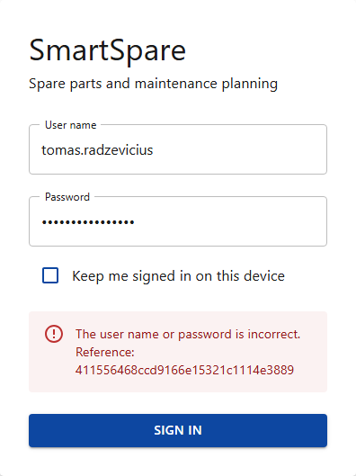
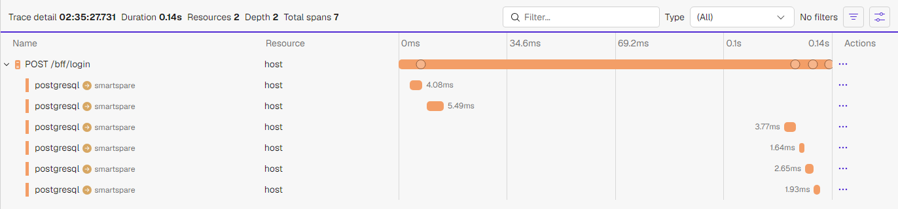

# Tracing a request from its error message

For support and the defence: how one error message leads to the full record of the request that caused it.

Every error the web client shows ends with **"Reference: &lt;trace id&gt;"**. That value is the W3C trace id of the failed request (#60, #72). The server returns the same id in the `traceId` field of every ProblemDetails, writes it into every log record of the request, and it identifies the request's trace in the telemetry backend.

## 1. Take the reference from the message

*Screenshot taken by the end-to-end smoke test (`tests/SmartSpare.E2E`) on a wrong password.*

The reference is 32 lower-case hexadecimal digits, here `411556468ccd9166e15321c1114e3889`. The message itself stays generic on purpose (SS-AUTH-001: the same response for a wrong password, an unknown user and a deactivated or anonymised user). The details are in the trace, which only operators can see.

## 2. Open the trace in the Aspire dashboard (development, single host)

1. Start the application with `dotnet run --project src/SmartSpare.AppHost`. The console prints the dashboard's sign-in link (`https://localhost:<port>/login?t=…`); open it.
2. Open **Traces** in the dashboard's side menu.
3. Find the trace by its id. The **Filter…** box on the Traces page matches trace and span names, not ids, so open the trace directly by changing the address to
   `https://localhost:<port>/traces/detail/<trace id>`.
   The page title then reads `host: POST /bff/login` followed by the first seven digits of the reference.

## 3. Read the span tree of `POST /bff/login`

A failed sign-in gives one trace with seven spans on the resource `host`:

| Span | What it is |
|---|---|
| `POST /bff/login` | The incoming request (ASP.NET Core instrumentation): route, status code 400, duration. The markers on its bar are the log records written during the request; select one to read it. |
| `postgresql` × 6 (database `smartspare`) | The database commands of the request (Npgsql instrumentation, ADR 0018), for example loading the user with roles and brands and setting the session context (`set_config('app.user_id', @user, …)`). |

Select a span to see its attributes. For a database span:
- `db.query.text` is the SQL with parameter placeholders (`@user`, `@roles`), never the values;
- `db.namespace` is the database;
- `db.npgsql.data_source` is the server and the login (for example `smartspare_api`), without a password;
- `TraceId` is the reference from the message, and `ParentId` is the request span.

Typical questions this answers: did the request reach the database at all, which command was slow, and which log record explains a 4xx or 5xx response. The trace never contains a password or a cookie. Requests to `/health/*` are not traced.

*The trace of a failed sign-in in the Aspire dashboard: the request span `POST /bff/login` and its six database commands.*

## 4. From stage 4: Grafana Tempo across services

In production the gateway and the six services export OTLP to Grafana Cloud ([ADR 0018](../adr/0018-observability-with-the-grafana-stack.md)). Locally, `--topology services` runs the same stack self-hosted: Grafana is the `grafana` resource in the Aspire dashboard. With the `GrafanaCloud:*` user secrets, the local topology also sends everything to the Grafana Cloud stack ([infra/grafana](../../infra/grafana/README.md)), so both work the same way.

**Find the request.** In Grafana, open **Explore**, choose the Tempo data source and enter the reference as the trace id. The request's trace contains:
- the gateway's server span and its proxied HTTP client span;
- the owning service's server span;
- the service's database commands (Npgsql);
- for a request that publishes an event, the outbox insert.

**Follow the event.** The outbox dispatcher publishes later, in its own activity. So the delivery is a **second trace**, which starts with the publish span and carries a **link** to the request's trace (STAGE_4_PLAN 6.5). It contains:
- the outbox publish;
- RabbitMQ.Client's own send and receive spans;
- the consumer's span in the receiving service;
- its inbox insert.

The `traceparent` travels in the message headers (ADR 0017), and the outbox row keeps the request's `traceparent` for the link. In Tempo, the publish span's **Links** open the request trace.

**Logs.** The Loki log records carry the same trace id (`trace_id`), so the logs of every service involved are found with it too, and the Loki data source links them back to Tempo.

Checked on 25 November 2026 with the diagnostics probe, Identity → RabbitMQ → Inventory, in the local Tempo (PR 4g-2). The topology CI job asserts the same link (`TopologyTests`).

Telemetry is kept for 14 days in Grafana Cloud Free, so a reference older than that can no longer be traced.
